# Capítulo 4 — Least-Squares Regression (Regresión por Mínimos Cuadrados)

**Resumen fiel en español del Capítulo 4 de *Optimization Bootcamp* (S. L. Brunton, borrador 2026, Cambridge University Press), páginas 122–166.**

Fuente: extracción `pdftotext` del PDF (`/data/MyTera/openclaw/workspace/notas/brunton-capitulo-4-fuente.txt`, páginas PDF 134–178 = páginas del libro 122–166, desplazamiento +12). Las 17 figuras del capítulo se extrajeron del PDF a `images/`.

---

## Convenciones de este documento (léase primero)

**Numeración de resultados.** A diferencia del Capítulo 3 (donde el libro no numera nada), el Capítulo 4 **sí numera explícitamente** un resultado y una observación:

- **Teorema 1 (Eckart–Young [159])**, p. 135 — la mejor aproximación de rango $r$ en norma de Frobenius y en norma espectral.
- **Observación 1 (Remark 1)**, p. 131 — la teoría de matrices aleatorias.

Todo lo demás (resultados en prosa, propiedades geométricas, relaciones entre subespacios, criterios de optimalidad) aparece en el libro como prosa o bajo subtítulos, sin etiqueta. Por eso la numeración **R4.1, R4.2, … es NUESTRA**: para cada resultado damos el nombre que el libro usa en prosa, la página y la idea de la demostración solo cuando el libro la da. Se marca explícitamente cuándo un resultado es una inferencia del expositor y no una afirmación del libro.

**Numeración de ejemplos.** El libro tampoco numera sus ejemplos; los etiqueta con subtítulos en negrita ("Example: Random Data", "Example: Cement Heat Generation", …). Los distinguimos como **E4.1, E4.2, …** (numeración nuestra) preservando el subtítulo del libro VERBATIM e indicando la sección.

**Ecuaciones.** Las ecuaciones sí llevan los números del libro: (4.1)–(4.100), con sub-etiquetas donde las hay ((4.5a)–(4.5c), (4.6a)–(4.6c), (4.9a)–(4.9b), (4.14a)–(4.14b), (4.22a)–(4.22b), (4.25a)–(4.25b), (4.42a)–(4.42b), (4.43a)–(4.43b), (4.46a)–(4.46b), (4.49a)–(4.49b), (4.51a)–(4.51b), (4.52a)–(4.52b), (4.64a)–(4.64b), (4.67a)–(4.67b), (4.95a)–(4.95c), (4.96a)–(4.96b)). **Las 119 ecuaciones numeradas del libro (100 números distintos) están presentes en este documento con su número original.**

**Regla de páginas (validada).** `pdftotext` emite una línea de encabezado que comienza con el carácter form-feed `\x0c` al INICIO de cada página; el entero que contiene esa línea es el número de página del texto que le SIGUE. En páginas pares el número va inmediatamente después del `\x0c` (p. ej. `\x0c124  CHAPTER 4. LEAST-SQUARES REGRESSION`) y en impares va al final de la línea (p. ej. `\x0c4.1. LEAST-SQUARES REGRESSION  125`); en ambos casos es el único entero de la línea. En este capítulo el **desplazamiento PDF → libro es +12** (la p. 128 del libro es la p. 140 del PDF). Validación por secciones: el capítulo abre en la p. 122 (libro) = 134 (PDF); §4.1 abre en 124 = 136; §4.2 en 131 = 143; §4.3 en 136 = 148; §4.4 en 139 = 151; §4.5 en 144 = 156; §4.6 en 146 = 158; §4.7 en 151 = 163; §4.8 en 156 = 168; *Suggested Reading* en 160 = 172; *Homework* en 161–166 = 173–178. Todas las ubicaciones coinciden con el índice del libro (pp. iv–v del PDF).

**Daños de extracción.** La extracción de este capítulo es **limpia**: no hubo interleaving de columnas ni fragmentos rotos como en el Capítulo 3. Los dos artefactos reales son (i) las **fracciones mal posicionadas** en las ecuaciones con cociente (p. ej. (4.6c), (4.25b), (4.26), (4.36), (4.39), (4.49), (4.67b), (4.78)), donde `pdftotext` separa numerador y denominador en líneas distintas, y (ii) los **comandos de shell** precedidos de `>>>` (p. ej. el recorte de la SVD por número de condición, p. 140). Todos fueron **reconstruidos y verificados contra las coordenadas reales del PDF** (`pdftotext -bbox-layout`), no reparados a ojo.

**Figuras.** Las 17 figuras se extrajeron del PDF como recortes PNG a 200 dpi (`images/fig_4_N.png`), delimitados automáticamente por el perfil de tinta de la página y verificados por OCR para descartar que incluyieran texto del cuerpo o de otras figuras.

---

## Panorama del capítulo (pp. 122–124)

El capítulo 4 construye, en orden, la cadena completa de la regresión lineal por mínimos cuadrados:

1. El **problema** y su solución analítica en forma cerrada vía pseudo-inversa de Moore–Penrose (§4.1).
2. La **herramienta numérica** que hace viable el cálculo: la descomposición en valores singulares (§4.2), que además da las mejores aproximaciones de bajo rango (teorema de Eckart–Young).
3. El **caso subdeterminado** y la regresión de norma mínima (§4.3), que abre la puerta a la **compresión sparsely** (*compressed sensing*).
4. El diagnóstico de **mala conditioning** y las herramientas de **regularización** —Tikhonov/ridge y LASSO— con el *bias-variance tradeoff* (§4.4).
5. La incorporación de **restricciones** mediante multiplicadores de Lagrange y condiciones KKT (§4.5), y el encuadre como **programación cuadrática** (§4.6).
6. La extensión **no lineal** con los métodos de **Gauss–Newton** y **Levenberg–Marquardt** (§4.7).
7. El método de **gradiente conjugado** para sistemas grandes y dispersos (§4.8).

### E4.0 — El problema en una línea (p. 122)

El sistema lineal

$$
Ax = b \tag{4.1}
$$

se convierte, cuando $A$ no es cuadrado, en el problema de optimización convexa

$$
\min_x \; \|Ax - b\|_2^2 \tag{4.2}
$$

cuya solución (analítica, cerrada) es

$$
x = A^\dagger b \tag{4.3}
$$

donde $A^\dagger$ es la **pseudo-inversa de Moore–Penrose**. La generalización no lineal es

$$
\min_\theta \; \|N_\theta(x) - y\|_2^2 \tag{4.4}
$$

(con $N_\theta$ una red neuronal, por ejemplo), que es **no convexa** y requiere métodos iterativos.

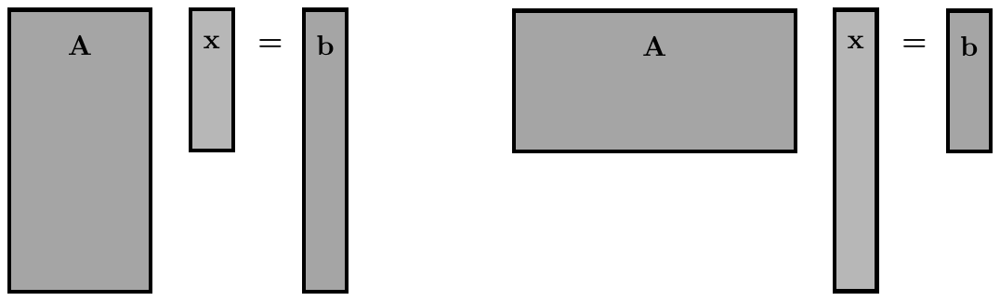

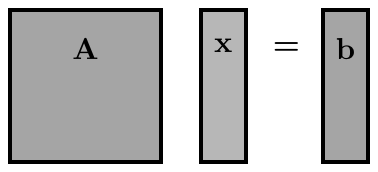

**Figura 4.1 (p. 123):** resolver $Ax=b$ con tantas ecuaciones como incógnitas equivale a invertir la matriz.

**Figura 4.2 (p. 123):** la regresión por mínimos cuadrados puede ser **sobredeterminada** (izquierda; más ecuaciones que incógnitas) o **subdeterminada** (derecha; menos ecuaciones que incógnitas).

**Motivación física (puente, p. 122).** Cada junta de un puente con muchas vigas experimenta fuerzas de las vigas conectadas y de las cargas aplicadas, y la suma debe estar en equilibrio. Se escribe una ecuación por junta: la suma de cargas aplicadas más las fuerzas internas desconocidas de las vigas es cero. Al reunir esas ecuaciones se obtienen las filas de la matriz $A$ (geometría de conexiones), el vector $x$ de fuerzas internas desconocidas y el vector $b$ de cargas externas. Resolver por $x$ es un **problema inverso**; con ruido en las mediciones de $b$ o imperfecciones en $A$, se convierte en un problema de mínimos cuadrados.

---

## 4.1  Least-Squares Regression (pp. 124–130)

### Ideas principales

**R4.1 — el modelo de regresión lineal (p. 124).** Dados datos de variables predictoras y sus resultados, ordenados como filas de una matriz $A \in \mathbb{R}^{m \times n}$ y un vector $b \in \mathbb{R}^m$, la regresión busca la relación entre las columnas de $A$ más consistente con los resultados en $b$. Dicha relación se cuantifica mediante

$$
Ax \approx b \tag{4.1}
$$

es decir, $b$ se aproxima como combinación lineal de las columnas de $A$, con pesos $x \in \mathbb{R}^n$. El vector $b$ suele estar contaminado con **ruido de medición**, que se modela típicamente como la adición de un vector $\epsilon$ de ruido blanco Gaussiano i.i.d.:

$$
b = b_{\text{true}} + \epsilon
$$

**R4.2 — solución analítica por condición de optimalidad (pp. 124–125).** El objetivo se expande:

$$
\|Ax - b\|_2^2 = (Ax - b)^T(Ax - b) \tag{4.5a}
$$
$$
= (x^T A^T - b^T)(Ax - b) \tag{4.5b}
$$
$$
= x^T A^T A x - x^T A^T b - b^T A x + b^T b \tag{4.5c}
$$

Diferenciando e igualando a cero:

$$
\nabla \|Ax - b\|_2^2 = 2A^T A x - A^T b - A^T b = 0 \tag{4.6a}
$$
$$
\Rightarrow A^T A x = A^T b \tag{4.6b}
$$
$$
\Rightarrow x = (A^T A)^{-1} A^T b \tag{4.6c}
$$

La matriz $A^\dagger = (A^T A)^{-1}A^T$ es la **pseudo-inversa de Moore–Penrose**. Está definida incluso para $A$ no cuadrado, **pero (4.6c) solo es válida cuando $A^T A$ es invertible**, es decir cuando $A$ tiene $n$ columnas linealmente independientes y $m \ge n$. **Conclusión clave: la fórmula solo aplica al caso sobredeterminado** (Fig. 4.2, izquierda).

**R4.3 — la pseudo-inversa vía SVD (p. 125).** En la práctica la pseudo-inversa de sistemas grandes se calcula con la descomposición en valores singulares. Si $A = U\Sigma V^T$, entonces

$$
A^\dagger = V\Sigma^{-1}U^T \quad \Rightarrow \quad x = V\Sigma^{-1}U^T b \tag{4.7}
$$

$U$ y $V$ son unitarias, así que invertirlas es tomar la transpuesta ($U^T U = I$, $V^T V = I$); $\Sigma$ es diagonal y por tanto también fácil de invertir.

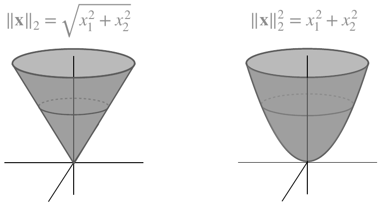

**Figura 4.3 (p. 126):** la norma raíz del error cuadrático medio $\|x\|_2 = \sqrt{x_1^2 + x_2^2}$ (izquierda) y la norma del error cuadrático $\|x\|_2^2 = x_1^2 + x_2^2$ (derecha), visualizadas en dos dimensiones.

### Ejemplos de regresión por mínimos cuadrados

**E4.1 — "Example: Random Data" (§4.1, p. 126).** Se generan datos aleatorios $A$ y $b$ y se resuelve por pseudo-inversa, calculada con la SVD. Código VERBATIM:

```python
import numpy as np

# Initialize A (m x n) and b (m x 1).
np.random.seed(42)
m, n = 20, 5
A = np.random.randn(m,n)
b = np.random.randn(m)

# Solve Least Squares Ax=b using SVD
U, S, VT = np.linalg.svd(A,full_matrices=0)
x = VT.T @ np.linalg.inv(np.diag(S)) @ U.T @ b

x = np.linalg.pinv(A) @ b               # Alternative
```

**E4.2 — "Example: Cement Heat Generation" (§4.1, pp. 126–128).** Conjunto de datos de ingeniería con el calor generado por distintas mezclas de cemento, con cuatro ingredientes básicos. $A \in \mathbb{R}^{13 \times 4}$ (cuatro ingredientes, 13 mezclas únicas). El objetivo es determinar los pesos $x$ que relacionan las proporciones de los cuatro ingredientes con la generación de calor. Código VERBATIM:

```python
A = np.loadtxt('hald_ingredients.csv')
b = np.loadtxt('hald_heat.csv')

# Solve Ax=b using SVD
U, S, VT = np.linalg.svd(A,full_matrices=0)
x = VT.T @ np.linalg.inv(np.diag(S)) @ U.T @ b

x = np.linalg.pinv(A) @ b                 # Alternative
```

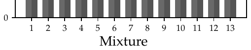

**Figura 4.5 (p. 128):** datos de calor para mezclas de cemento con cuatro ingredientes básicos.

Los coeficientes $x_j$ del ajuste (tabla en la p. 128) son:

| Ingrediente | $x_j$ |
|---|---|
| Tricalcium aluminate | 2.1930 |
| Tricalcium silicate | 1.1533 |
| Tetracalcium alumiferrite | 0.7585 |
| Beta-dicalcium silicate | 0.4863 |

**E4.3 — "Example: Boston Housing Data" (§4.1, p. 128).** Conjunto de datos mayor (UCI Machine Learning Repository [18]) para determinar qué factores predicen mejor los precios del mercado inmobiliario de Boston [218]. Hay **13 atributos** correlacionados con el precio (tasa de criminalidad per cápita, tasa de impuesto predial, …). El ajuste se grafica contra el valor real de la casa (Fig. 4.6). Aunque el valor no se predice perfectamente, la tendencia concuerda bien: **los valores extremos más altos no suelen capturarse bien con ajustes lineales simples**.

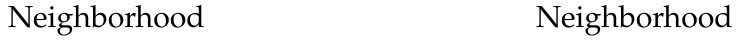

**Figura 4.6 (p. 128):** regresión multilineal de precios de vivienda usando varios factores: (a) datos sin ordenar y (b) datos ordenados por valor de vivienda.

El problema contiene precios y atributos de **506 viviendas**, así que la matriz de atributos es de tamaño $506 \times 13$. **Es importante rellenar esta matriz con una columna adicional de unos**, para tener en cuenta la posibilidad de un término constante no nulo en la fórmula de regresión. Esto corresponde a la "ordenada al origen" (*y intercept*) de una regresión lineal unidimensional simple. El libro señala que **rellenar $A$ con una columna de unos es lo mismo que normalizar restando la media de su columna**.

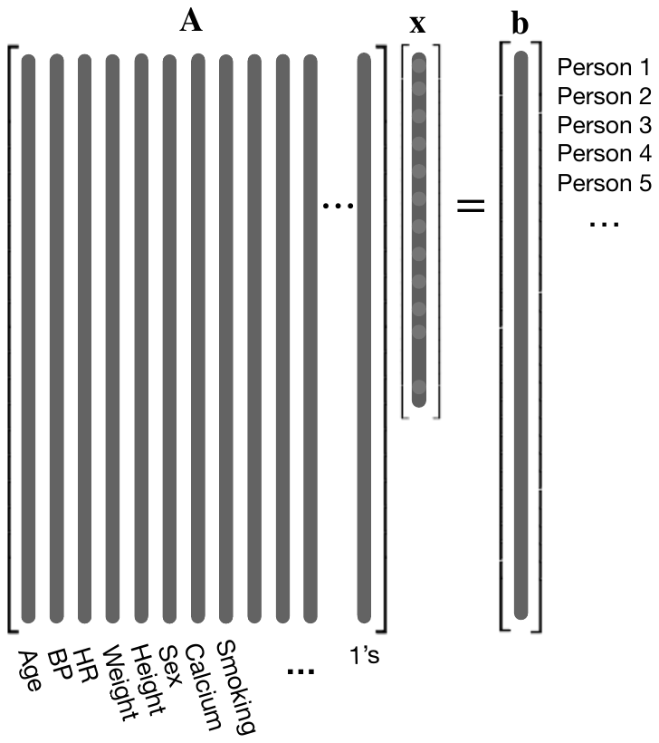

**Figura 4.4 (p. 127):** esquema ilustrativo de cómo los datos de un problema de regresión se forman en matrices y vectores. En el ejemplo aludido en la introducción, se tienen datos de salud ($A$) y resultados ($b$) de varios pacientes. El vector desconocido $x$ representa los coeficientes del modelo que predice $b$ dada la información en $A$. En secciones posteriores se usará regularización dispersa para encontrar las pocas columnas de $A$ que mejor correlacionan con $b$.

### Outliers y otras normas

**R4.4 — sensibilidad a outliers y regresión LAD (pp. 128–129).** La regresión por mínimos cuadrados es **sensible a outliers grandes** en los datos, que sesgan todo el ajuste, porque el error de un outlier va **cuadrado**, lo que lo pondera desproporcionadamente frente a los puntos con error pequeño.

La alternativa robusta es minimizar la suma de valores absolutos de los errores:

$$
\|Ax - b\|_1 \tag{4.8}
$$

denominada **regresión de desviación absoluta mínima (LAD, *least absolute deviation*)**. Como los errores no se elevan al cuadrado, los outliers grandes no sesgan desproporcionadamente la regresión. **Tema general de optimización: usar la norma $\|\cdot\|_1$ del error como función de pérdida suele ser más robusto a outliers.**

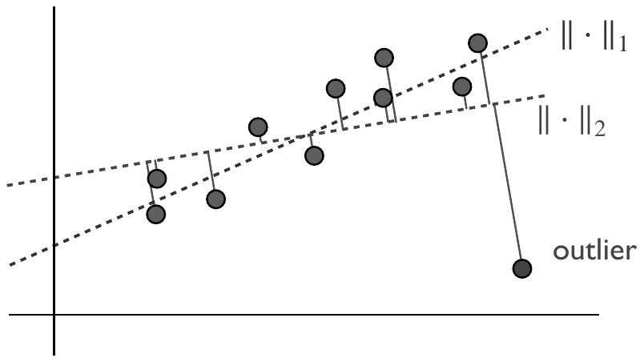

**Figura 4.7 (p. 129):** la regresión por mínimos cuadrados, es decir, minimizar la norma $\|\cdot\|_2^2$, es sensible a outliers, ya que el cuadrado de la distancia al outlier sesga todo el ajuste. La regresión de desviación absoluta mínima, es decir, minimizar la norma $\|\cdot\|_1$, es más robusta a outliers.

**Código 4.1 (p. 129) — uso de la norma $\ell_1$ para regresión estadística robusta. VERBATIM:**

```python
x = np.sort(4*(np.random.rand(25,1)-0.5),axis=0) # data
b = 0.9*x + 0.1*np.random.randn(len(x),1) # Noisy line y=ax
atrue = np.linalg.lstsq(x,b,rcond=None)[0] # Least-squares a

b[-1] = -5.5 # Introduce outlier
acorrupt = np.linalg.lstsq(x,b,rcond=None)[0] # New slope

## L1 optimization to reject outlier
def L1_norm(a):
    return np.linalg.norm(a*x-b,ord=1)
a0 = acorrupt   # initialize to L2 solution
res = minimize(L1_norm, a0)
aL1 = res.x[0]        # aL1 is robust
```

### ¿Cuándo una matriz está sobredeterminada o subdeterminada?

**R4.5 — los dos regímenes (pp. 129–130).** Una matriz no cuadrada $A$ puede ser de uno de dos tipos:

- **Subdeterminada:** $A \in \mathbb{R}^{m \times n}$ con $m \ll n$ (matriz *short-fat*, "corta y ancha"): hay menos ecuaciones que incógnitas. Es probable que sus columnas generen todo $\mathbb{R}^m$, pues tiene muchas más columnas que las necesarias para una base linealmente independiente. Genéricamente, si una matriz short-fat tiene $m$ columnas linealmente independientes (i.e. su espacio columna es $\mathbb{R}^m$), entonces hay **infinitamente soluciones** $x$ para todo $b$. Se llama subdeterminada porque no hay suficientes valores en $b$ para determinar unívocamente el $x$ de dimensión mayor.
- **Sobredeterminada:** $A$ *tall-skinny* ("alta y delgada") con $m \gg n$: más ecuaciones que incógnitas. Esta matriz **no puede** tener $m$ columnas linealmente independientes, así que está garantizado que hay vectores $b$ sin solución $x$. De hecho, habrá solución solo si $b$ está en el espacio columna de $A$, i.e. $b \in \mathrm{col}(A)$.

*Nota al pie 1 (p. 130):* es fácil construir ejemplos degenerados donde las columnas de una matriz short-fat no forman una base completa de $\mathbb{R}^m$, como

$$
A = \begin{pmatrix} 1 & 1 & 1 & 1 \\ 1 & 1 & 1 & 1 \end{pmatrix}
$$

### Los cuatro subespacios fundamentales

**R4.6 — los cuatro subespacios fundamentales (pp. 130–131).** El espacio de soluciones del sistema (4.1) queda determinado por:

- **Espacio columna**, $\mathrm{col}(A)$: el span de las columnas de $A$, también llamado *rango* (*range*).
- **Espacio fila**, $\mathrm{row}(A)$: el span de las filas de $A$. Nótese que $\mathrm{row}(A) = \mathrm{col}(A^T)$.
- **Espacio nulo (kernel)**, $\ker(A)$: el complemento ortogonal de $\mathrm{row}(A)$, también llamado *espacio nulo* (*null space*). Es el subespacio de vectores que se mapean por $A$ a cero, i.e. $Ax = 0$.
- **El complemento ortogonal de** $\mathrm{col}(A)$, que es $\ker(A^T)$.

En consecuencia:

- Si $b \in \mathrm{col}(A)$ **y** $\dim(\ker(A)) \ne 0$, hay **infinitas soluciones** $x$. La condición $\dim(\ker(A)) \ne 0$ está garantizada para una matriz short-fat.
- Si $b \notin \mathrm{col}(A)$, **no hay soluciones**, y el sistema (4.1) se llama **inconsistente**.

**R4.7 — las descomposiciones en suma directa (p. 131).** Los subespacios fundamentales satisfacen:

$$
\mathrm{col}(A) \oplus \ker(A^T) = \mathbb{R}^n \tag{4.9a}
$$
$$
\mathrm{col}(A^T) \oplus \ker(A) = \mathbb{R}^n \tag{4.9b}
$$

donde $\oplus$ significa **suma directa** de subespacios: $U \oplus V = \{u + v : u \in U,\, v \in V\}$, con la propiedad adicional de que la descomposición es única, $U \cap V = \{0\}$. Así, $\mathrm{col}(A) \oplus \ker(A^T) = \mathbb{R}^n$ significa que todo vector de $\mathbb{R}^n$ se puede escribir de manera única como suma de un vector del espacio columna y un vector del espacio nulo, y los dos subespacios sólo se intersecan en el vector cero.

> **Verificación de la extracción.** Las ecuaciones (4.9a) y (4.9b) aparecen en el PDF con los superíndices desalineados por el interlineado. Se comprobó por coordenadas (`pdftotext -bbox-layout`) que el exponente de $\mathbb{R}$ es **$n$** en ambas (glifo `n` en itálica matemática, ancho 5.14 px), y no $m$ (ancho 7.49 px) como podría sugerir una lectura rápida.

> **Observación 1 (Remark 1, p. 131).** Existe una literatura extensa sobre teoría de matrices aleatorias, donde los estereotipos anteriores son casi seguro ciertos, es decir, ciertos con alta probabilidad. Por ejemplo, es extremadamente improbable que un sistema $Ax=b$ tenga solución para una matriz aleatoria $A \in \mathbb{R}^{m\times n}$ y un vector aleatorio $b \in \mathbb{R}^m$ con $m \gg n$, ya que hay poca probabilidad de que $b$ esté en el espacio columna de $A$. Estas propiedades de las matrices aleatorias tienen un papel importante en los problemas de optimización inversa dispersa.

**Panel 4.1 (p. 130): Least Absolute Deviation or Least Squares?** Ha habido un gran debate sobre el uso de la norma $\|\cdot\|_2$ frente a $\|\cdot\|_1$ en regresión durante más de doscientos años. **Gauss y Legendre** introdujeron independientemente la regresión por mínimos cuadrados a principios del siglo XIX. **Cincuenta años antes, en 1757, Boscovich** introdujo la regresión LAD para resolver problemas relacionados con estimar la forma de la Tierra. Hoy se tienen fundamentos matemáticos firmes sobre qué información previa cuantifican estas normas, relacionados con la estadística bayesiana y los problemas inversos (Capítulos 7 y 8). En términos generales: **la regresión por mínimos cuadrados es un estimador de la media** de una distribución, mientras que **la regresión de desviación absoluta mínima estima la mediana**; la mediana es conocida por ser más robusta a outliers. De hecho, la regresión por mínimos cuadrados es un estimador **no sesgado de la media** suponiendo ruido Gaussiano en el vector de medición $b$.

> *Nota al pie a (p. 130):* un ejemplo es la riqueza media frente a la mediana en los Estados Unidos, a septiembre de 2024: la **mediana de riqueza es ∼ \$200k**, mientras que la **media es ∼ \$1,000k** a causa de un número relativamente pequeño de individuos extremadamente ricos, *aka* outliers.

**R4.8 — las dos soluciones canónicas (p. 131).** En el caso sobredeterminado sin solución, se busca la solución $x$ que minimiza el error cuadrático $\|Ax-b\|_2^2$, la **solución de mínimos cuadrados**; nótese que esa solución también minimiza $\|Ax-b\|_2$. En el caso subdeterminado con infinitas soluciones, se busca la solución $x$ de **norma mínima** $\|x\|_2$ con $Ax=b$, la **solución de norma mínima**.

---

## 4.2  Singular Value Decomposition (pp. 131–136)

### Ideas principales

**R4.9 — la SVD como herramienta de elección (pp. 131–132).** La descomposición en valores singulares es **la técnica de elección para los problemas de inversión de matrices grandes**. Proporciona una descomposición **numéricamente estable**, garantizada que existe, y que sirve para varios propósitos: obtener **aproximaciones óptimas de bajo rango** de una matriz y calcular **pseudo-inversas** de matrices no cuadradas para resolver $Ax=b$. **La SVD es también el algoritmo subyacente al análisis de componentes principales (PCA)**, donde datos de alta dimensión se descomponen en sus factores estadísticamente más descriptivos.

La SVD completa se denota

$$
A = U\Sigma V^T \tag{4.10}
$$

donde $U \in \mathbb{R}^{m\times m}$ y $V \in \mathbb{R}^{n\times n}$ son matrices **ortogonales** (con columnas ortonormales) y $\Sigma \in \mathbb{R}^{m\times n}$ es una matriz con entradas reales no negativas en la diagonal y ceros fuera de ella. Las columnas de $U$ son los **vectores singulares izquierdos** de $A$ y las columnas de $V$ los **derechos**. Los elementos diagonales de $\Sigma$ son los **valores singulares**, ordenados de mayor a menor:

$$
\sigma_1 \ge \sigma_2 \ge \cdots \ge \sigma_n \ge 0
$$

*Nota al pie 2 (p. 132):* una matriz cuadrada $U$ es ortogonal si $UU^T = U^T U = I$. Si $A$ tiene valores complejos, $U$ y $V$ pasan a ser **unitarias**, con $U^*U = UU^* = I$ y $V^*V = VV^* = I$, donde $*$ denota la transpuesta conjugada compleja. Las matrices ortogonales son siempre unitarias.

Para matrices complejas $A \in \mathbb{C}^{m\times n}$ se usa la **transpuesta conjugada** $*$ en lugar de la transpuesta real $T$. Para matrices reales, $A^* = A^T$.

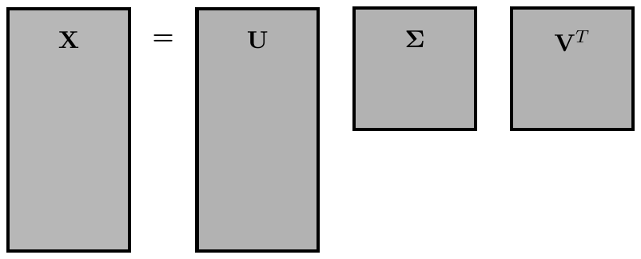

**Figura 4.8 (p. 132):** la descomposición en valores singulares de una matriz $X$ proporciona una descomposición jerárquica en un conjunto de filas y columnas ortogonales que capturan mejor la varianza de los datos.

**R4.10 — la SVD económica y el truncamiento (p. 132).** Cuando $m \ge n$, la matriz $\Sigma$ tiene a lo sumo $n$ elementos no nulos en la diagonal. Si hay columnas linealmente dependientes en $A$, habrá aún menos valores singulares no nulos. Denotando por $\hat{\Sigma}$ la matriz diagonal de los valores singulares no nulos, es posible representar exactamente $A$ mediante la **SVD económica**:

$$
A = U\Sigma V^T = \hat{U}\begin{bmatrix}\hat{\Sigma} \\ 0\end{bmatrix}V^T = \hat{U}\hat{\Sigma}V^T \tag{4.11}
$$

donde $\hat{U}$ son las columnas correspondientes a los valores singulares no nulos de $\hat{\Sigma}$ y $\hat{U}^\perp$ es su complemento ortogonal. **El rango de $A$ es igual al número de valores singulares no nulos.**

La SVD también da la **aproximación óptima de rango $r$** de $A = \tilde{U}\tilde{\Sigma}\tilde{V}^T$, donde el rango $r < n$ se elige para retener los valores singulares más grandes: $\tilde{U}$ y $\tilde{V}$ contienen las primeras $r$ columnas de $U$ y $V$, y $\tilde{\Sigma}$ contiene el bloque $r \times r$ de $\Sigma$.

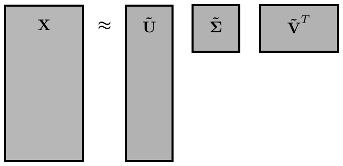

**Figura 4.9 (p. 133):** la descomposición en valores singulares truncada aproxima una matriz $X$ usando los primeros $r$ valores singulares y vectores singulares.

**R4.11 — los subespacios fundamentales en términos de $U$ y $V$ (p. 133).**

- El **espacio columna** de $A$ es el mismo que el espacio columna de $\hat{U}$.
- El **complemento ortogonal** del espacio columna de $A$ está dado por el espacio columna de $\hat{U}^\perp$.
- El **espacio fila** de $A$ está generado por las columnas de $V$.
- El **espacio nulo** de $A$ está dado por $\mathrm{col}(V^\perp)$.

> **Panel 4.2 (p. 133): The SVD as a Sum of Rank-1 Matrices.** En esencia, porque $\Sigma$ es diagonal, la SVD puede entenderse como una **suma de matrices de rango 1**, dadas por $\sigma_j u_j v_j^T$:
>
> $$
> X \approx \sigma_1 u_1 v_1^T + \sigma_2 u_2 v_2^T + \cdots + \sigma_r u_r v_r^T
> $$
>
> Esto será útil al calcular cotas de error de la aproximación SVD, por ejemplo en el teorema de Eckart–Young.

### Regresión por mínimos cuadrados con la SVD

**R4.12 — la pseudo-inversa izquierda de Moore–Penrose (p. 134).** Se sustituye una SVD truncada exacta $A = \hat{U}\hat{\Sigma}V^T$ en el problema y se "invierte" cada una de las matrices $\hat{U}$, $\hat{\Sigma}$ y $V^T$ por turno, obteniendo la **pseudo-inversa izquierda de Moore–Penrose** $A^\dagger$:

$$
A^\dagger \triangleq V\hat{\Sigma}^{-1}\hat{U}^T \quad \Rightarrow \quad A^\dagger A = VV^T \tag{4.12}
$$

Nótese que $A^\dagger A$ será igual a la identidad $I_{n\times n}$ **solo si la SVD truncada captura todos los valores singulares no nulos**; si se usa una aproximación de rango $r$, entonces $\tilde{V}\tilde{V}^T \ne I_{n\times n}$ y solo aproxima la identidad. Con esto se obtienen las soluciones de norma mínima y de mínimos cuadrados de (4.1):

$$
A^\dagger A x^* = A^\dagger b \quad \Rightarrow \quad x^* = V\hat{\Sigma}^{-1}\hat{U}^T b \tag{4.13}
$$

Sustituyendo la solución $x^*$ de vuelta en (4.1):

$$
Ax^* = \hat{U}\hat{\Sigma}V^T V\hat{\Sigma}^{-1}\hat{U}^T b \tag{4.14a}
$$
$$
= \hat{U}\hat{U}^T b \tag{4.14b}
$$

Es decir, **esta solución es una proyección del vector $b$ sobre el espacio generado por las columnas de $\hat{U}$**. Si $b$ no está en el span de $A$ (y por tanto tampoco en el de $\hat{U}$), $x^*$ solo resolverá aproximadamente la ecuación y quedará un error residual de las componentes de $b$ que no están en el span de $A$. Nótese que $\hat{U}\hat{U}^T$ **no** es la identidad cuando $n < m$, aunque $V^T V$ sí lo es, ya que $V$ es una matriz ortogonal $n \times n$ de rango completo.

### Computación de la SVD

**R4.13 — el algoritmo (p. 134).** Algorítmicamente, la SVD se computa **reduciendo primero la matriz $A$ a una matriz bidiagonal** y luego usando un algoritmo iterativo para computar la SVD de la matriz bidiagonal. Para matrices con **alta relación de aspecto** (i.e. $m \gg n$), el primer paso puede hacerse computando primero una **factorización QR** para reducir $A$ a una matriz triangular superior, seguida de **reflejos de Householder** para reducir esa triangular superior a forma bidiagonal [76, 495]. El segundo paso puede hacerse con el **algoritmo QR modificado de Golub & Kahan** [198]. Para una discusión más detallada: [198, 84, 200].

```python
>>> import numpy as np
>>> X = np.random.rand(5, 3) # create random data matrix
>>> U, S, VT = np.linalg.svd(X,full_matrices=True) #full SVD
>>> Uhat, Shat, VThat = np.linalg.svd(X,full_matrices=False) # economy SVD
```

**R4.14 — costo computacional (p. 134).** Computar la pseudo-inversa $A^\dagger$ es computacionalmente eficiente, **después del costoso trabajo previo de computar la SVD**. Invertir las matrices unitarias $\hat{U}$ y $\tilde{V}$ implica multiplicaciones por las matrices transpuestas, que son operaciones $O(m^2)$. Invertir $\tilde{\Sigma}$ es aún más eficiente, al ser una matriz diagonal: requiere $O(m)$ operaciones. **En contraste, invertir una matriz cuadrada densa requeriría $O(m^3)$ de operaciones.**

### Aproximación óptima y cotas de error

**R4.15 — la SVD es en sí misma una solución global de un problema de optimización (p. 135).** Para un rango $r$ dado, **no hay mejor aproximación de $X$ en sentido $\ell_2$** que la aproximación por SVD truncada $\tilde{X}$. El **teorema de Eckart–Young** lo enuncia con precisión y da las expresiones del error de la aproximación truncada. Así, datos de alta dimensión pueden estar bien descritos por unos pocos patrones dominantes dados por las columnas de $\hat{U}$ y $\tilde{V}$.

**Schmidt** (el de Gram–Schmidt) generalizó la SVD a espacios de funciones y desarrolló un teorema de aproximación, estableciendo la SVD truncada $\tilde{X}$ como la aproximación óptima de bajo rango de la matriz subyacente $X$ [441]. El **teorema de aproximación de Schmidt** fue redescubierto por Eckart y Young [159], y a veces se lo llama **teorema de Eckart–Young**.

> **Teorema 1 (Eckart–Young [159], p. 135).** La aproximación óptima de rango $r$ de $X$, en sentido de mínimos cuadrados, está dada por la truncación SVD de rango $r$, $\tilde{X}$:
>
> $$
> \underset{\tilde{X},\; \mathrm{rank}(\tilde{X})=r}{\arg\min}\; \|X - \tilde{X}\|_F = \tilde{U}\tilde{\Sigma}\tilde{V}^T \tag{4.15}
> $$
>
> donde $\tilde{U}$ y $\tilde{V}$ denotan las primeras $r$ columnas de $U$ y $V$, y $\tilde{\Sigma}$ contiene el bloque $r \times r$ de $\Sigma$. La **norma de Frobenius** se define como
>
> $$
> \|X\|_F = \left(\sum_{i=1}^{n}\sum_{j=1}^{m} |X_{ij}|^2\right)^{1/2}
> $$
>
> que es equivalente a la norma 2 del vectorizado $X(:)$.

**R4.16 — error exacto de la aproximación de rango $r$ (p. 135).** Es posible cuantificar exactamente el error:

$$
\|X - \tilde{X}\|_F^2 = \sum_{k=r+1}^{m} \sigma_k^2 \tag{4.16}
$$

Es decir, **todas las otras matrices de rango $r$ tendrán al menos este error**. Como el error escala con el tamaño y la magnitud de $X$, suele ser más útil considerar el **error relativo**

$$
\frac{\|X-\tilde{X}\|_F^2}{\|X\|_F^2} \tag{4.17}
$$

que tiene la interpretación de la **cantidad de varianza faltante** en la aproximación $\tilde{X}$; es una propiedad usada extensivamente en el PCA.

**R4.17 — optimalidad también en la norma 2 (espectral) (p. 135).** Sorprendentemente, la SVD también proporciona una aproximación óptima de rango $r$ en la **norma 2 de matriz**, también conocida como **norma espectral**:

$$
\underset{\tilde{X},\; \mathrm{rank}(\tilde{X})=r}{\arg\min}\; \|X - \tilde{X}\|_2 = \tilde{U}\tilde{\Sigma}\tilde{V}^T \tag{4.18}
$$

donde $\|X\|_2 = \max_{v \ne 0} \frac{\|Xv\|}{\|v\|_2}$. La expresión del error en la norma 2 es aún más simple:

$$
\|X - \tilde{X}\|_2 = \sigma_{r+1} \tag{4.19}
$$

Esta expresión se deriva fácilmente expandiendo

$$
X - \tilde{X} = \sum_{k=r+1}^{m} \sigma_k u_k v_k^T \tag{4.20}
$$

Como los vectores $v_k$ son ortonormales, el máximo $\|(X-\tilde{X})v\|_2 = \sigma_{r+1}$ se alcanza para $v = v_{r+1}$.

---

## 4.3  Minimum Norm Regression (pp. 136–139)

### Ideas principales

**R4.18 — el problema de norma mínima (p. 136).** Es similar al de mínimos cuadrados, salvo que ahora se considera el caso **subdeterminado**

$$
Ax = b \tag{4.21}
$$

donde $A$ es una matriz short-fat, de modo que hay menos ecuaciones que incógnitas; en este caso, bajo condiciones suaves, habrá infinitos vectores $x$ que resuelven el sistema. El problema de regresión de norma mínima busca el $x$ que satisface el sistema de ecuaciones y tiene la **norma $\ell_2$ mínima**:

$$
\min_x \; \|x\|_2^2 \tag{4.22a}
$$
$$
\text{s.t. } Ax = b \tag{4.22b}
$$

**Importante: aquí se minimiza la norma $\|x\|_2^2$ y no $\|Ax-b\|_2$**; el sistema de ecuaciones entra como **restricción**.

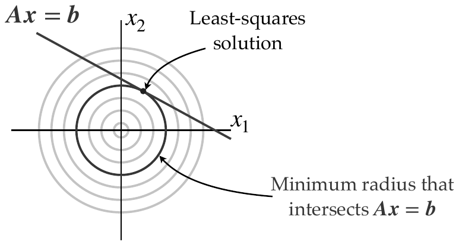

**Figura 4.10 (p. 136):** los conjuntos de nivel de la norma $\ell_2$ de $x$ son círculos, y la solución de mínimos cuadrados da el punto $x$ sobre $Ax=b$ que interseca el conjunto de nivel de radio mínimo de esta norma.

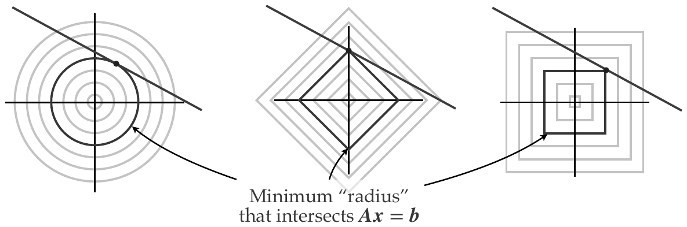

**Figura 4.11 (p. 137):** las normas $\ell_2$, $\ell_1$ y $\ell_\infty$ de $x$ visualizadas con la recta $Ax=b$ en dos dimensiones.

**R4.19 — derivación con multiplicadores de Lagrange (p. 137).** Se usa la forma de multiplicadores de Lagrange (introducida en §1.4, desarrollada en el Capítulo 6) y se expande el objetivo $\|x\|_2^2 = x^T x$:

$$
L(x, \lambda) = x^T x + \lambda^T(Ax - b) \tag{4.23}
$$

La condición de gradiente respecto a $x$ es

$$
\nabla_x L = 2x + A^T\lambda = 0 \quad \Rightarrow \quad x = -\tfrac{1}{2}A^T\lambda \tag{4.24}
$$

y la condición de gradiente respecto a $\lambda$ es

$$
\nabla_\lambda L = Ax - b = 0 \quad \Rightarrow \quad -AA^T\lambda = b \tag{4.25a}
$$
$$
\Rightarrow \lambda = -2(AA^T)^{-1}b \tag{4.25b}
$$

lo que lleva a

$$
x = -\tfrac{1}{2}A^T\lambda = A^T(AA^T)^{-1}b \tag{4.26}
$$

Esta es la **pseudo-inversa derecha de Moore–Penrose**:

$$
x = A^T(AA^T)^{-1}b \tag{4.27}
$$

Puede computarse con la SVD, como en la regresión por mínimos cuadrados: si $A = U\Sigma V^T$ entonces $x = V\Sigma^{-1}U^T b$.

### Compressed Sensing

**R4.20 — por qué la compresión sparse funciona (p. 137).** La mayoría de las señales naturales, como imágenes y audio, son **altamente compresibles** [76]. Cuando la señal se escribe en una base apropiada (Fourier o wavelet, p. ej.), solo unos pocos modos están activos, con coeficientes grandes; los modos restantes tienen un efecto despreciable y sus pequeños coeficientes pueden truncarse a cero, reduciendo el número de coeficientes que hay que almacenar y transmitir para una representación precisa. Esta compresibilidad es la base de la compresión moderna de imagen y audio, como JPEG y MP3.

Sin embargo, hasta hace poco las imágenes y el audio se recolectaban **en resolución completa**, solo para ser comprimidos después para su almacenamiento y transferencia. Recientemente, en los últimos veinte años, este paradigma se dio vuelta: en el **compressed sensing** se recolecta una pequeña submuestra aleatoria de los datos originales de alta dimensión y luego se infiere qué coeficientes Fourier o wavelet son grandes y están activos en la señal. Por ejemplo, en vez de recolectar el millón de píxeles de una imagen de un megapíxel, puede ser posible recolectar el 10% de los píxeles al azar e inferir los modos Fourier grandes de la imagen JPEG comprimida.

**R4.21 — formulación del problema (pp. 138–139).** El compressed sensing es un problema de regresión subdeterminado muy desafiante en el que, en lugar de buscar la solución de norma $\|\cdot\|_2$ mínima, se busca la **solución más dispersa** de un sistema de ecuaciones.

Una señal compresible $x \in \mathbb{R}^n$ puede escribirse como un vector disperso $s \in \mathbb{R}^n$ (conteniendo sobre todo ceros) en una base de transformación $\Psi \in \mathbb{R}^{n\times n}$:

$$
x = \Psi s \tag{4.28}
$$

El vector $s$ se llama **$K$-disperso en $\Psi$** (*K-sparse*) si tiene exactamente $K$ elementos no nulos. Si la base $\Psi$ es genérica (Fourier o wavelet), solo los pocos términos activos de $s$ se necesitan para reconstruir la señal original $x$, reduciendo los datos requeridos. Imágenes y audio son compresibles en bases Fourier o wavelet, así que tras la transformación la mayoría de los coeficientes son pequeños y pueden fijarse en cero con pérdida de calidad despreciable.

El objetivo es **medir un subconjunto pequeño** de la señal original en un vector de mediciones $y \in \mathbb{R}^p$ e inferir el vector disperso $s$ consistente con esas mediciones. Las mediciones se relacionan con el estado completo $x$ mediante $y = Cx$, donde $C \in \mathbb{R}^{p\times n}$ es una **matriz de medición** con $p \ll n$:

$$
y = Cx = C\Psi s = \Theta s \tag{4.29}
$$

El sistema (4.29) es subdeterminado, pues hay infinitas soluciones $s$ consistentes. La solución más dispersa $\hat{s}$ satisface:

$$
\hat{s} = \underset{s}{\arg\min}\; \|s\|_0 \quad \text{s.t. } y = C\Psi s \tag{4.30}
$$

donde $\|\cdot\|_0$ es la **pseudo-norma $\ell_0$**, dada por el número de entradas no nulas; se conoce también como la **cardinalidad** de $s$.

**R4.22 — la dificultad computacional y la relajación (pp. 138–139).** La optimización (4.30) es **no convexa**, y en general la solución global solo puede encontrarse con una **búsqueda exhaustiva combinatoria** en $n$ y $K$. En particular, deben verificarse todos los vectores $K$-dispersos posibles en $\mathbb{R}^n$; si el nivel exacto de dispersidad $K$ se desconoce, la búsqueda es aún más amplia. Por ser combinatoria, resolver (4.30) es **intratable** incluso para $n$ y $K$ moderadamente grandes, y la perspectiva de resolver problemas mayores no mejora con la ley de Moore de crecimiento exponencial del poder computacional.

Afortunadamente, bajo ciertas condiciones sobre la matriz de medición $C$, es posible **relajar** la optimización (4.30) a una minimización $\ell_1$ convexa [93, 146]:

$$
\hat{s} = \underset{s}{\arg\min}\; \|s\|_1 \quad \text{s.t. } y = C\Psi s \tag{4.31}
$$

**La norma $\ell_1$ también se conoce como norma taxicab o de Manhattan**, porque representa la distancia que recorrería un taxi entre dos puntos de una grilla rectangular. **La solución de norma $\ell_1$ mínima es dispersa, mientras que la solución de norma $\ell_2$ mínima no lo es.**

El libro señala además que en §5.1 se muestra que es posible usar los **métodos de gradiente proximal y de separación** (*splitting*) para resolver eficientemente soluciones locales de este problema no convexo, y que la solución global $\ell_1$ puede usarse como **inicialización** del gradiente proximal sobre el problema $\ell_0$ original.

> **Panel 4.3 (p. 139): Alternative Formulation of Compressed Sensing.** Además de la minimización $\ell_1$ de (4.31), hay enfoques alternativos basados en **algoritmos voraces** (*greedy*) [496, 497, 499, 498, 501, 225, 500, 189, 502, 187, 358, 188] que determinan la solución dispersa de (4.29) mediante un problema iterativo de *matching pursuit*. Por ejemplo, el **compressed sensing matching pursuit (CoSaMP)** [358] es computacionalmente eficiente y fácil de implementar.
>
> Cuando las mediciones $y$ tienen ruido aditivo, por ejemplo ruido blanco de magnitud $\epsilon$, la siguiente variante de (4.31) puede ser más robusta [508]:
>
> $$
> \hat{s} = \underset{s}{\arg\min}\; \|s\|_1 \quad \text{s.t. } \|C\Psi s - y\|_2 < \epsilon \tag{4.32}
> $$
>
> Una optimización convexa relacionada es la siguiente [11]:
>
> $$
> \hat{s} = \underset{s}{\arg\min}\; \|C\Psi s - y\|_2 + \lambda\|s\|_1 \tag{4.33}
> $$
>
> donde $\lambda \ge 0$ es un parámetro que pondera la importancia de la dispersidad. Las ecuaciones (4.32) y (4.33) están estrechamente relacionadas [499]. Esto es muy similar a la regresión LASSO que se introduce en (4.40), pero para el problema subdeterminado de compressed sensing.

---

## 4.4  Condition Number and Regularization (pp. 139–144)

### Ideas principales

**R4.23 — el problema de la conditioning (p. 139).** Muy a menudo el problema de regresión por mínimos cuadrados está **mal condicionado**, lo que significa que las columnas de $A$ son casi linealmente dependientes. En ese caso, la pseudo-inversa **amplifica el ruido** del vector $b$, introduciendo alta varianza y un alto grado de incertidumbre en la estimación $x$.

En esta sección se define formalmente el **número de condición**, concepto fundamental en regresión y optimización usado en el resto del libro; luego se introduce la **regularización de Tikhonov** (también llamada *ridge regression*), que mejora la conditioning de los problemas mal condicionados, disminuyendo la varianza pero introduciendo sesgo; y se introduce la **regresión LASSO**, que promueve la dispersidad del vector solución $x$.

### Número de condición

**R4.24 — definición (p. 140).** El número de condición de una matriz $A$ mide **cuán sensible es la multiplicación y la inversión de matrices a errores en la entrada**. Un número de condición mayor indica mayor sensibilidad y peor desempeño. El número de condición $\kappa(A)$ está directamente relacionado con los valores singulares:

$$
\kappa(A) = \frac{\sigma_{\max}(A)}{\sigma_{\min}(A)} \tag{4.34}
$$

El número de condición es un concepto central en todo el álgebra lineal numérica y la computación aplicada.

**R4.25 — propagación del error (pp. 140–141).** El efecto de un número de condición grande se entiende mejor en el sistema $Ax=b$. Si $b$ no está especificado perfectamente, sino que tiene algún error $\epsilon_b$, el sistema se vuelve

$$
A(x + \epsilon_x) = b + \epsilon_b \tag{4.35}
$$

donde $\epsilon_x$ es el error correspondiente en $x$. Suponiendo el **peor caso**, donde $\epsilon_b$ está alineado con el vector singular correspondiente al valor singular mínimo $\sigma_{\min}$, y $b$ está alineado con el vector singular correspondiente al máximo $\sigma_{\max}$, la solución estimada es

$$
x + \epsilon_x \approx A^\dagger(b + \epsilon_b) = \frac{1}{\sigma_{\max}}b + \frac{1}{\sigma_{\min}}\epsilon_b \tag{4.36}
$$

La relación señal-ruido de la estimación $x$ es

$$
\frac{\|x\|}{\|\epsilon_x\|} = \frac{\sigma_{\min}}{\sigma_{\max}}\frac{\|b\|}{\|\epsilon_b\|}
$$

es decir, **degradada por un factor igual al número de condición $\kappa(A)$**. Por tanto, **el ruido en $b$ es amplificado por el número de condición en el proceso de inversión**.

Incluso si $b$ y $\epsilon_b$ no están perfectamente alineados con las direcciones de peor caso, es probable que tengan alguna componente de todos los vectores singulares; en ese caso, las componentes del error todavía experimentarán amplificación grande respecto a las otras componentes de la salida deseada.

**R4.26 — mitigación por truncamiento de la SVD (p. 140).** Una forma de mitigar un número de condición grande es **truncar la SVD de forma más agresiva**, aumentando el valor singular mínimo efectivo $\sigma_{\min}$. El costo es reducir el tamaño del subespacio $\hat{U}$ usado para aproximar la salida.

```python
>>> kappanew = 1e-5 # Desired condition number
>>> U, S, Vt = np.linalg.svd(A, full_matrices=False)
>>> r = np.sum(S > np.max(S) * kappanew)
>>> invA = Vt[:r,:].T @ np.linalg.inv(np.diag(S[:r])) @ U[:,:r].T # Rank-r approximation
```

### Regularización de Tikhonov

**R4.27 — el problema y su solución (p. 141).** La regularización de Tikhonov [491], también conocida como **ridge regression** [231], ataca el mal número de condición de la regresión por mínimos cuadrados cuando las columnas de $A$ son casi paralelas y el número de condición de la pseudo-inversa es grande.

Recordando que cuando $A$ no es cuadrado no se puede invertir, y en su lugar se computa la pseudo-inversa vía SVD:

$$
A = U\Sigma V^T \quad \Rightarrow \quad A^\dagger = V\Sigma^{-1}U^T = \cdots = (A^TA)^{-1}A^T \tag{4.37}
$$

Cuando las columnas de $A$ son casi paralelas, el número de condición de $A$ es grande, y por tanto **el número de condición de $A^T A$ es aún mayor**. Esto se manifiesta en que la matriz diagonal $\Sigma$ tiene valores singulares casi degenerados, de modo que invertir $\Sigma^{-1}$ implica dividir por números muy pequeños.

**R4.28 — el término de regularización y la solución analítica (p. 141).** Cualquier ruido en $b$ será amplificado por esta pseudo-inversa mal condicionada. El efecto es que algunas entradas de $x$ quedan grandes y opuestas, produciendo alta varianza. Dicho de otro modo: si se muestrea desde muchas instancias de pequeño ruido en $b$, se obtiene un **elipsoide grande y muy excéntrico** de soluciones $x$ centrado en la solución verdadera (Fig. 4.12).

Una solución es **regularizar** el problema de mínimos cuadrados con un término de pérdida adicional $\|x\|_2^2$:

$$
x = \underset{x'}{\arg\min}\; \|Ax' - b\|_2^2 + \alpha\|x'\|_2^2 \tag{4.38}
$$

donde $\alpha$ es un **hiperparámetro** que pondera este término regularizador. Es posible computar el gradiente de este objetivo aumentado e igualarlo a cero, dando la solución analítica:

$$
x = (A^TA + \alpha I)^{-1}A^Tb \tag{4.39}
$$

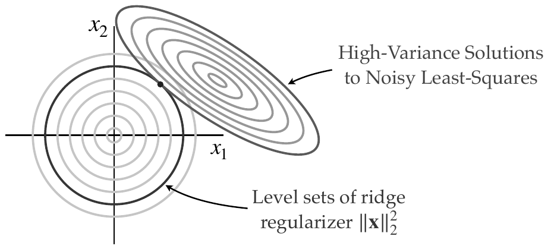

**Figura 4.12 (p. 141):** esquemática de la regularización de Tikhonov, aka ridge regression. El problema original de mínimos cuadrados mal condicionado tiene alta varianza, visualizada por las elipses azules excéntricas, que representan las soluciones dada ruido Gaussiano en el vector $b$. La regularización de Tikhonov arrastra estas soluciones hacia los conjuntos de nivel de $\|x\|_2^2$, mostrados como círculos rojos.

**R4.29 — interpretación como multiplicador de Lagrange y el *bias-variance tradeoff* (p. 142).** El término adicional $\alpha\|x\|_2^2$ puede verse como Proveniente de un **multiplicador de Lagrange** que impone la condición $\|x\|_2^2 = c$, con $c$ constante (i.e. $\alpha(\|x\|_2^2 - c)$). Esto funciona para cualquier constante $c$, ya que esencialmente promueve que las entradas individuales de $x$ sean similares en magnitud, en lugar de tener entradas muy grandes y opuestas que se cancelen entre sí, como ocurre cuando $A$ está mal condicionado.

Esto conduce a una **propiedad fundamental** en muchos problemas de optimización regularizados: el ***bias-variance tradeoff***. El problema original tiene alta varianza, así que se añade regularización; pero este término de regularización introduce un **sesgo** hacia una solución donde las entradas de $x$ están en el círculo unitario (Fig. 4.13).

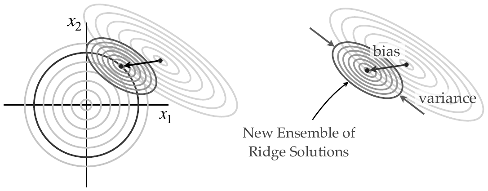

**Figura 4.13 (p. 142):** esquemática del compromiso sesgo-varianza en la regularización de Tikhonov. La solución regularizada está representada por las elipses azul oscuro, que tienen menor varianza que la solución original, dada por las elipses azul claro. Sin embargo, la regularización de Tikhonov introduce un **sesgo**, desplazando la media de la nueva distribución.

**R4.30 — perspectiva bayesiana (p. 142).** Existe también una perspectiva bayesiana de la regresión ridge, donde el regularizador ridge **surge de un prior bayesiano** que las entradas de $x$ son variables aleatorias Gaussianas con media cero y la misma varianza. El libro lo desarrolla en el Capítulo 7.

**R4.31 — ridge regression vía SVD (p. 142).** No debe sorprender que (4.39) se pueda computar con la SVD, sin invertir la matriz cuadrada $(A^TA + \alpha I)$. Sustituyendo $A = U\Sigma V^T$:

$$
(A^TA + \alpha I)^{-1} = (V\Sigma^2 V^T + \alpha I)^{-1}
$$
$$
= (V\Sigma^2 V^T + \alpha VIV^T)^{-1}
$$
$$
= (V(\Sigma^2 + \alpha I)V^T)^{-1}
$$

Esto puede invertirse simplemente, ya que $V$ es unitaria y $\Sigma^2 + \alpha I$ es diagonal. **Esencialmente, se le suma $\alpha$ veces la matriz identidad a los valores singulares al cuadrado en el paso de inversión de la matriz.**

### Regresión dispersa: LASSO y elastic net

**R4.32 — el LASSO (pp. 142–143).** El **LASSO** (*least absolute shrinkage and selection operator*) es una técnica de regresión penalizada con $\ell_1$ que equilibra la complejidad del modelo con su capacidad descriptiva [490]. Es muy similar a la regresión ridge, pero con una penalización $\ell_1$ sobre $x$ en lugar de $\ell_2$.

**Historia (p. 142).** La norma $\ell_1$ fue introducida antes como penalización en 1969 [384], con algoritmos especializados en 1973 [111], y como pérdida robusta en geofísica en 1973 [107]. Otras técnicas relacionadas que promueven dispersidad se han explorado después [17, 95, 418, 23, 542]. Este principio de **parsimonia** en un modelo refleja la **navaja de Occam**: entre todas las descripciones posibles, el modelo correcto más simple es probablemente el verdadero. Desde su aparición por **Tibshirani en 1996** [490], el LASSO se ha convertido en una piedra angular de la modelación estadística, con muchas variantes modernas y técnicas relacionadas [219, 533, 246]. El LASSO está estrechamente relacionado con el anterior **nonnegative garrote** de Breiman [67], y también con el trabajo previo sobre **soft-thresholding** de Donoho y Johnstone [147, 148].

La regresión por mínimos cuadrados tiende a producir un vector $x$ con **coeficientes no nulos en todas las entradas**, lo que indica que deben usarse todas las columnas de $A$ para predecir $b$. Sin embargo, a menudo creemos que el modelo estadístico debe ser más simple, de modo que $x$ sea **disperso**. El LASSO añade un término de penalización $\ell_1$ para regularizar el problema de mínimos cuadrados, es decir, para **prevenir el sobreajuste**:

$$
x = \underset{x'}{\arg\min}\; \|Ax' - b\|_2^2 + \lambda\|x'\|_1 \tag{4.40}
$$

**R4.33 — selección de $\lambda$ por validación cruzada (p. 143).** Típicamente el parámetro $\lambda$ se varía a lo largo de un rango de valores y el ajuste se valida contra un conjunto de prueba de datos retenidos (*holdout*). Si no hay datos suficientes para tener un conjunto de entrenamiento y de prueba suficientemente grande, es común **entrenar y probar el modelo repetidamente sobre selecciones aleatorias de los datos** (a menudo 80% para entrenamiento y 20% para prueba), dando un desempeño con **validación cruzada**. Este procedimiento de validación cruzada permite seleccionar un modelo **parcimonioso** con relativamente pocos términos y evita el sobreajuste.

**R4.34 — interpretabilidad (p. 143).** La regresión LASSO se usa con frecuencia para construir modelos estadísticos de enfermedades, como cáncer e insuficiencia cardíaca, ya que hay muchos predictores posibles (demográficos, estilo de vida, biométricos, información genética). **La interpretabilidad es importante** en los modelos estadísticos, porque estos modelos a menudo se comunican a una audiencia no técnica, incluidos líderes de negocio y tomadores de decisión de política pública. En general, un modelo de regresión es más interpretable si tiene menos términos que influyen en el resultado, lo que motiva otra perspectiva más sobre la dispersidad.

La regresión LASSO funciona bien con problemas sobredeterminados, ya que estos son frecuentes en sistemas estadísticos. El libro señala que una versión temprana de la imagen geométrica de la Fig. 4.14, que explica la naturaleza dispersante de la norma $\ell_1$, fue presentada en el artículo de Tibshirani de 1996 [490].

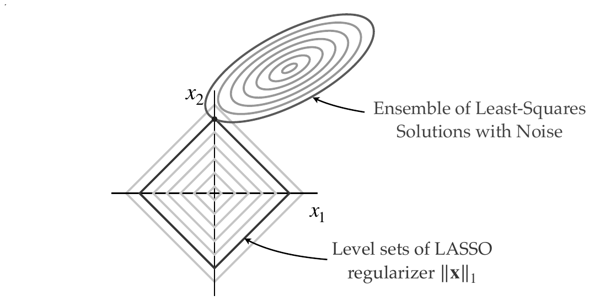

**Figura 4.14 (p. 143):** esquemática de la regularización LASSO, para promover dispersidad.

**R4.35 — elastic net (p. 144).** El **elastic net** [558] combina los términos de regularización ridge y LASSO:

$$
x = \underset{x'}{\arg\min}\; \|Ax' - b\|_2^2 + \lambda\|x'\|_1 + \alpha\|x'\|_2^2 \tag{4.41}
$$

La regresión elastic net se usa ampliamente en aplicaciones de aprendizaje automático.

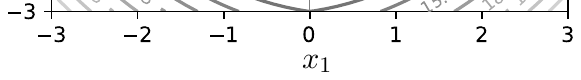

**Figura 4.15 (p. 144):** conjuntos de nivel de la regularización *elastic net* de (4.41) para $\lambda = \alpha = 1$. Esto es análogo a los conjuntos de nivel del regularizador LASSO de la Fig. 4.14. Nótese que los contornos del *elastic net* se parecen a los de la norma $\ell_{3/2}$.

---

## 4.5  Constrained Least-Squares (pp. 144–146)

### Ideas principales

**R4.36 — por qué restringir (p. 144).** Hasta ahora solo se ha considerado la regresión por mínimos cuadrados **no restringida**. Sin embargo, muchos sistemas tienen restricciones sobre los valores admisibles de $x$. Por ejemplo, se puede saber que algunos valores de $x$ deben ser no negativos, o puede haber otro conocimiento previo, como cierta simetría en los coeficientes de $x$, o que las entradas de $x$ deben estar dentro de cotas inferiores y superiores (i.e. **restricciones de caja**, *box constraints*). Otras restricciones comunes incluyen restricciones de igualdad sobre los coeficientes $Cx = d$. El libro desarrolla las restricciones con mucho más detalle y generalidad en el Capítulo 6; aquí introduce las **restricciones de igualdad más simples** en mínimos cuadrados.

**R4.37 — el problema restringido y su forma cuadrática (p. 145).** La solución de mínimos cuadrados restringida para restricciones lineales de igualdad se deriva de

$$
\min_x \; \|Ax - b\|_2^2 \tag{4.42a}
$$
$$
\text{s.t. } Cx = d \tag{4.42b}
$$

Expandiendo el objetivo, puede escribirse como un **programa cuadrático con restricciones lineales de igualdad**:

$$
\min_x \; \tfrac{1}{2}x^T Q x + c^T x \tag{4.43a}
$$
$$
\text{s.t. } Cx = d \tag{4.43b}
$$

con las matrices

$$
Q = 2A^TA \qquad c^T = -2b^TA \tag{4.44}
$$

**R4.38 — Lagrange augmented y condiciones KKT (p. 145).** Se pueden usar multiplicadores de Lagrange para augmentar el objetivo con la ecuación de restricción, dando el **Lagrangian aumentado**:

$$
L(x,\lambda) = \tfrac{1}{2}x^TQx + c^Tx + \lambda^T(Cx - d) \tag{4.45}
$$

Las condiciones de optimalidad son $\nabla_x L = 0$ y $\nabla_\lambda L = 0$, que dan la **condición de stationarity** y la **condición de restricción de igualdad** respectivamente:

$$
\nabla_x L = Qx + c + C^T\lambda = 0 \tag{4.46a}
$$
$$
\nabla_\lambda L = Cx - d = 0 \tag{4.46b}
$$

Reescribiendo en forma matricial:

$$
\begin{bmatrix} Q & C^T \\ C & 0 \end{bmatrix}\begin{bmatrix} x \\ \lambda \end{bmatrix} = \begin{bmatrix} -c \\ d \end{bmatrix} \tag{4.47}
$$

Y en términos de las matrices y vectores originales del problema restringido:

$$
\begin{bmatrix} 2A^TA & C^T \\ C & 0 \end{bmatrix}\begin{bmatrix} x \\ \lambda \end{bmatrix} = \begin{bmatrix} 2A^Tb \\ d \end{bmatrix} \tag{4.48}
$$

Es posible resolver por $x$ y $\lambda$ **invirtiendo este sistema de ecuaciones matricial**, de nuevo usando SVD o factorización QR. Es claro que **si no hay restricciones, esto es equivalente al problema estándar de mínimos cuadrados**.

### La norma mínima como problema restringido

**R4.39 — caso particular (p. 146).** Si $A = I$ y $b = 0$, entonces los mínimos cuadrados restringidos se reducen al problema de norma mínima anterior. Específicamente, al resolver

$$
\min_x \; \|x\|_2^2 \tag{4.49a}
$$
$$
\text{s.t. } Cx = d \tag{4.49b}
$$

el problema restringido se convierte en

$$
\begin{bmatrix} I & C^T \\ C & 0 \end{bmatrix}\begin{bmatrix} x \\ \lambda \end{bmatrix} = \begin{bmatrix} 0 \\ d \end{bmatrix} \tag{4.50}
$$

que tiene la solución óptima

$$
x^* = C^T(CC^T)^{-1}d
$$

---

## 4.6  Quadratic Programming (pp. 146–150)

### Ideas principales

**R4.40 — definición (p. 146).** Los mínimos cuadrados lineales pueden escribirse como un **programa cuadrático**, que generaliza la programación lineal a funciones objetivo cuadráticas. Un programa cuadrático se escribe en forma estándar como:

$$
\min_x \; \tfrac{1}{2}x^TQx + c^Tx \tag{4.51a}
$$
$$
\text{Subject to: } Ax \le b \tag{4.51b}
$$

donde $Q$ es una matriz **simétrica**.

**R4.41 — convexidad y casos (p. 146).** Si $Q$ es **semidefinida positiva**, de modo que $x^TQx \ge 0$ para todo $x \in \mathbb{R}^n$, entonces el programa cuadrático es **convexo** y **cualquier mínimo local es un mínimo global**. Si $Q$ es **indefinida**, el programa cuadrático es no convexo, y el enfoque para resolverlo puede ser mucho más complicado.

En el caso de $Q$ semidefinida positiva hay varios casos según si las restricciones están activas o no:

- Si las restricciones son **inactivas**, el valor óptimo puede ocurrir en un **punto interior** del conjunto factible.
- Si las restricciones son **activas**, el óptimo puede vivir **en cualquier parte de la frontera** del conjunto factible.

En programación lineal la solución ocurría en los **vértices**, pero para programación cuadrática con restricciones activas, el valor óptimo puede ocurrir en una **arista**, una **cara** o un **vértice**. Por ello puede ser más difícil buscar soluciones, porque no hay un **método de búsqueda simplex** obvio.

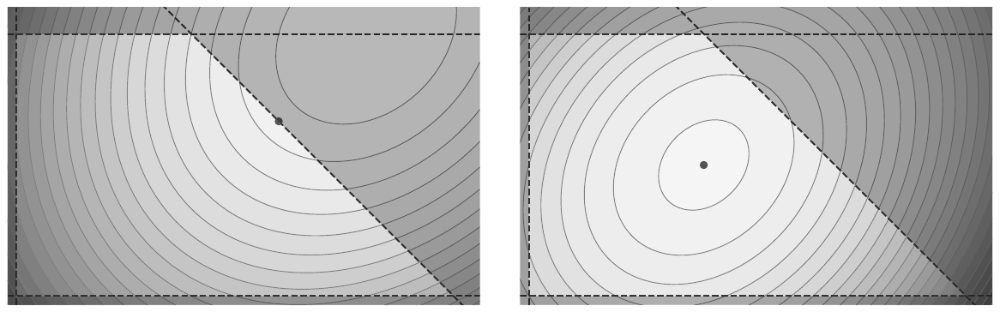

**Figura 4.16 (p. 147):** un programa cuadrático puede tener restricciones inactivas (izquierda), de modo que el mínimo está en un punto interior de la región factible; alternativamente, puede tener restricciones activas (derecha), de modo que el mínimo está en la frontera de la región factible. Se visualiza el politopo factible convexo en morado con los conjuntos de nivel de la función objetivo cuadrática en rojo.

**R4.42 — los dos enfoques principales (p. 146).**

- **Métodos de conjunto activo (active set methods).** La idea es **adivinar qué restricciones están activas** y luego resolver un problema menor con solo esas restricciones activas. En términos gruesos, si $a_j^Tx \le b_j$ está activa, entonces $a_j^Tx = b_j$, y se puede resolver el problema de mínimos cuadrados restringido con esa restricción activa usando métodos KKT. **El método simplex de Dantzig del Capítulo 3 es un método de conjunto activo.**
- **Métodos de punto interior (interior point methods, IPMs).** Son uno de los enfoques líderes para resolver tanto problemas de programación lineal como cuadrática en alta dimensión. **Escalan bien** a sistemas grandes cuando hay restricciones lineales activas como $Ax \le b$. Se desarrollan con mucho más detalle en el Capítulo 6.

**R4.43 — programación cuadrática secuencial (SQP) (p. 147).** La **programación cuadrática secuencial** es un enfoque potente para resolver problemas de optimización no lineal restringida iterando sobre una secuencia de subproblemas cuadráticos. En cada iteración, SQP aproxima el objetivo y las restricciones no lineales originales mediante una **expansión de Taylor de segundo orden** y **linearización**, respectivamente. El QP resultante captura tanto la **curvatura** como la **estructura de restricciones**, y se resuelve usando métodos de conjunto activo o de punto interior. **Los problemas originales no necesitan ser convexos**, aunque en ese caso no hay garantía de optimalidad global. Los métodos SQP ofrecen **convergencia local rápida, a menudo superlineal**, y se usan ampliamente en aplicaciones de ingeniería y control debido a su robustez y compatibilidad con el manejo de restricciones.

### Los mínimos cuadrados como programa cuadrático

**R4.44 (p. 147).** Es simple ver que el problema de mínimos cuadrados lineales es un programa cuadrático:

$$
\min_x \; \|Ax - b\|_2^2 = (Ax-b)^T(Ax-b) \tag{4.52a}
$$
$$
= x^TA^TAx - 2b^TAx + b^Tb \tag{4.52b}
$$

Así, esta función de pérdida es una forma cuadrática con

$$
Q = A^TA \qquad c^T = -2b^TA \tag{4.53}
$$

Se ve que $Q$ es **simétrica y semidefinida positiva** para cualquier matriz $A$ del problema original de mínimos cuadrados, por lo que el programa cuadrático resultante es **convexo**.

### Ejemplos de programación cuadrática en Python

**R4.45 — herramientas (p. 148).** En Python se pueden resolver QPs convexos cómodamente con **cvxpy**, de forma similar a como se resuelven los programas lineales. Otras bibliotecas incluyen **qpsolvers** y **OSQP**. El paquete cvxpy **analiza automáticamente si el problema es un QP**, incluso con restricciones adicionales. Si el problema es un QP, se elige un **solvers especializado** (e.g. OSQP) si está disponible. Para QPs grandes, la factorización directa o los **warm starts** con OSQP o GUROBI pueden ser beneficiosos. El usuario también puede afinar el desempeño, por ejemplo con `prob.solve(solver=cp.OSQP, warm_start=True)`.

**Cualquier regresión por mínimos cuadrados puede resolverse como un programa cuadrático**: se minimiza un objetivo cuadrático (i.e. los residuos al cuadrado) sujeto a restricciones lineales o afines sobre los parámetros. El libro explora los mínimos cuadrados restringidos con más detalle en el Capítulo 6.

**E4.4 — "Python Example: Least-Squares as a Quadratic Program" (p. 148).** Código VERBATIM:

```python
import cvxpy as cp
import numpy as np

# Initialize A (m x n) and b (m x 1).
np.random.seed(0)
m, n = 20, 5
A = np.random.randn(m,n)
b = np.random.randn(m)

# Unconstrained Least Squares
x = cp.Variable(n) # Regression coefficients
objective = cp.Minimize(cp.sum_squares(A@x - b))

prob = cp.Problem(objective)
result = prob.solve()

print("Optimal value:", result)
print("Optimal x:", x.value)
```

Ahora se incluye la restricción lineal $x_j \ge 0.5$ y $\sum_j x_j \le 3$:

```python
# Constrained Least Squares
x_constrained = cp.Variable(n)
constraints = [ x_constrained >= 0.5,
                cp.sum(x_constrained) <= 3.0 ]

obj_constrained = cp.Minimize(cp.sum_squares(A@x_constrained - b))
prob_constrained = cp.Problem(obj_constrained, constraints)
result_constrained = prob_constrained.solve()
```

**E4.5 — "Portfolio Optimization (Markowitz Model)" (pp. 148–149).** Un QP canónico surge en la **optimización de portafolios**: se elige $x$, la fracción del presupuesto total en cada activo, para minimizar el riesgo sujeto a un rendimiento objetivo y otras restricciones:

$$
\min_x \; \tfrac{1}{2}x^T\Sigma x
$$
$$
\text{s.t. } r^Tx \ge R_0, \quad \mathbf{1}^Tx = 1, \quad x \ge 0
$$

(El libro presenta este modelo **sin número de ecuación**; se reproduce aquí tal cual.)

Aquí, $\Sigma$ es la **matriz de covarianza** de los rendimientos, indicando cierta dispersión del riesgo; $r$ es el vector de **rendimientos esperados** por activo; $R_0$ es un rendimiento mínimo aceptable; y $x \ge 0$ garantiza que **no haya ventas en corto** (*no short-selling*).

Código VERBATIM:

```python
n = 5 # Example data has n=5 points
Sigma = np.array([[0.05,0.01,0.02,0.0,0.0],
                  [0.01,0.06,0.0,0.01,0.0],
                  [0.02,0.0,0.07,0.01,0.0],
                  [0.0,0.01,0.01,0.05,0.01],
                  [0.0,0.0,0.0,0.01,0.04]]) # 5x5 covariance
r = np.array([0.10,0.12,0.14,0.09,0.11]) # expected returns
R0 = 0.11                                 # target return

x = cp.Variable(n, nonneg=True)                  # decision variable

# Objective: minimize x^T Sigma x
objective = cp.Minimize(0.5 * cp.quad_form(x, Sigma))

constraints = [
    cp.sum(x) == 1,                  # sum of allocations = 1
    r @ x >= R0                      # minimum return
]

prob = cp.Problem(objective, constraints)
result = prob.solve(solver=cp.SCS)
print("Optimal risk:", result)
print("Optimal x:", x.value)
print("Return of portfolio:", r @ x.value)
```

**E4.6 — "Regularized Least-Squares with Box Constraints" (pp. 149–150).** Se implementa un mínimo cuadrado regularizado con Tikhonov y restricciones de caja adicionales sobre el estado: $l_j \le x_j \le u_j$. El libro revisita las restricciones de caja en §6.2 usando multiplicadores de Lagrange y las condiciones KKT. Código VERBATIM:

```python
np.random.seed(42)
m, n = 8, 4

A = np.random.randn(m,n)
b = np.random.randn(m)
alpha = 0.2

x = cp.Variable(n)          # Decision variable x in R^n

# Objective: (1/2)*||A x - b||^2 + alpha/2 * ||x||^2
objective = cp.Minimize( 0.5*cp.sum_squares(A@x - b) + 0.5*alpha*cp.
    sum_squares(x) )

# Example box constraints: -1 <= x_i <= 2
l, u = -1.0, 2.0
constraints = [ x >= l, x <= u ]

prob = cp.Problem(objective, constraints)
res = prob.solve(solver=cp.OSQP)
print("Optimal value:", res)
print("x =", x.value)
```

Este problema es un objetivo cuadrático con restricciones lineales, soluble por solvers QP estándar como OSQP, ECOS, SCS u otros en cvxpy.

**E4.7 — "A Quadratic Cost with Additional Linear Coupling Constraints" (p. 150).** Supongamos que se tienen dos variables $x, y \in \mathbb{R}^n$ y se quiere minimizar

$$
\tfrac{1}{2}\|Ax - b\|^2 + \tfrac{1}{2}\|Cy - d\|^2
$$

sujeto a una **restricción de acoplamiento** $Dx + Ey \le f$. Este es un escenario típico de **multi-bloque**. Código VERBATIM:

```python
np.random.seed(0)
n = 4
A = np.random.randn(6,n)
b = np.random.randn(6)
C = np.random.randn(6,n)
d = np.random.randn(6)

D = np.random.randn(3,n)
E = np.random.randn(3,n)
f = np.array([1,2,3])

x = cp.Variable(n)
y = cp.Variable(n)

obj = 0.5*cp.sum_squares(A@x - b) + 0.5*cp.sum_squares(C@y - d)

constraints = [D@x + E@y <= f]

prob = cp.Problem(cp.Minimize(obj), constraints)
res = prob.solve()
print("Objective val:", res)
print("x =", x.value)
print("y =", y.value)
```

Aquí, el objetivo es la suma de dos términos de mínimos cuadrados separados, y se atan $x$ e $y$ con la restricción lineal $Dx + Ey \le f$, convirtiéndolo en un único QP. cvxpy maneja automáticamente la combinación de términos cuadráticos y restricciones lineales.

---

## 4.7  Nonlinear Least-Squares: Gauss-Newton Methods (pp. 151–156)

### Ideas principales

**R4.46 — el problema no lineal (p. 151).** Al pasar de los mínimos cuadrados simples (4.2) a los mínimos cuadrados no lineales (4.4), el problema **ya no es convexo y no hay solución en forma cerrada**. Los **métodos de Gauss–Newton** son una clase potente de técnicas iterativas para resolver estos problemas no lineales. Se usa la notación:

$$
L = \tfrac{1}{2}\sum_{j=1}^{m}\|y_j - N(x_j;\theta)\|_2^2 = \tfrac{1}{2}\sum_{j=1}^{m} f_j(\theta)^2 = \|\mathbf{f}(\theta)\|_2^2 \tag{4.54}
$$

La suma de $j=1$ a $m$ es típicamente una suma sobre $m$ puntos de datos $\{(x_j,y_j)\}_{j=1}^m$, de modo que se minimiza el error cuadrático de un ajuste de función sobre todos los datos. La función $\mathbf{f}(\theta)$ es el **vector de residuos normados**, de modo que cada $f_j(\theta) = \|r_j\|_2$ donde el error residual es $r_j = y_j - N(x_j)$ evaluado en el $j$-ésimo punto de datos. Las variables $\theta$ son los **parámetros del modelo de regresión no lineal** y son las variables sobre las que se optimiza.

Esta formulación de mínimos cuadrados no lineales es **muy general**, y engloba gran parte del **entrenamiento de redes neuronales**, entre otros problemas de regresión no lineal. En el caso de una red neuronal (Capítulo 10), $N$ representa la red y $\theta$ es el vector de pesos y sesgos que se entrena para minimizar la función de pérdida.

**R4.47 — el gradiente y el Jacobiano (pp. 151–152).** Resolver $\min_\theta \|\mathbf{f}(\theta)\|_2$ equivale a encontrar puntos donde $\nabla_\theta L = 0$ con curvatura positiva. Es un sistema no lineal de ecuaciones, que lleva a un problema de optimización no convexo, así que se resuelve con **métodos iterativos** (descenso de gradiente o método de Newton). Similarmente a otros métodos de Newton para problemas grandes, aquí se **aproxima el Hessiano**; de este modo Gauss–Newton se parece al método cuasi-Newton del Capítulo 2, en que ambos aproximan el Hessiano con una construcción definida positiva, aunque suelen considerarse clases distintas por haber divergido en implementaciones y casos de uso.

El gradiente es

$$
\nabla_\theta L = \sum_{j=1}^{m} f_j(\theta)\nabla f_j(\theta) = J^T\mathbf{f} \tag{4.55}
$$

donde $J$ es la **matriz jacobiana** de derivadas

$$
J = D\mathbf{f} = \begin{bmatrix} \dfrac{\partial f_1}{\partial \theta_1} & \dfrac{\partial f_1}{\partial \theta_2} & \cdots & \nabla f_1^T \\ \dfrac{\partial f_2}{\partial \theta_1} & \dfrac{\partial f_2}{\partial \theta_2} & \cdots & \nabla f_2^T \\ \vdots & \vdots & \ddots & \vdots \end{bmatrix} = \begin{bmatrix} \nabla f_1^T \\ \nabla f_2^T \\ \vdots \end{bmatrix} \tag{4.56}
$$

y su transpuesta es

$$
J^T = \begin{bmatrix} \nabla f_1 & \nabla f_2 & \cdots \end{bmatrix} \tag{4.57}
$$

Así, $J^T\mathbf{f}$ produce la suma de (4.55).

**R4.48 — el Hessiano y su aproximación de Gauss–Newton (p. 152).** Se escribe una expresión para el Hessiano $H = \nabla_\theta^2 L$:

$$
H = \nabla_\theta^2 L = J^TJ + \sum_{j=1}^{m} f_j(\theta)\nabla^2 f_j(\theta) = J^TJ + Q \tag{4.58}
$$

El primer término solo incluye derivadas de primer orden, y el segundo contiene derivadas de segundo orden. Para muchos problemas es demasiado costoso computar $Q$. Afortunadamente, como $f_j(\theta)$ son los errores residuales, es común suponer que son pequeños y **aproximar el Hessiano solo con los términos de primer orden**:

$$
H \approx J^TJ \tag{4.59}
$$

**Esta es la suposición primaria usada en los métodos de Gauss–Newton.**

**R4.49 — la iteración (pp. 152–153).** El método de Newton se vuelve:

$$
\theta^{k+1} = \theta^k - H^{-1}\nabla_\theta L \tag{4.60}
$$

Sin embargo, en lugar de almacenar y computar $H^{-1}$, lo que implicaría operaciones $O(n^3)$, se resuelve el sistema lineal

$$
Hs^k = -\nabla_\theta L \tag{4.61}
$$

y se usa directamente $s^k$, que debería ser igual a $H^{-1}\nabla_\theta L$, para la actualización en el método de Newton:

$$
\theta^{k+1} = \theta^k + s^k \tag{4.62}
$$

Usando la aproximación de Gauss–Newton al Hessiano de (4.59), esto se convierte en

$$
J_k^TJ_k s^k \approx -J_k^T\mathbf{f}(\theta^k) \tag{4.63}
$$

donde $J_k = J(\theta^k) = D\mathbf{f}(\theta^k)$. Por tanto, la **iteración completa de Gauss–Newton** es

$$
\text{Solve } J_k^TJ_k s^k = -J_k^T\mathbf{f}(\theta^k) \tag{4.64a}
$$
$$
\text{Iterate } \theta^{k+1} = \theta^k + s^k \tag{4.64b}
$$

Así, **los métodos de Gauss–Newton reducen el problema de mínimos cuadrados no lineales a una secuencia de problemas de mínimos cuadrados regulares linealizados**[^fn1].

**R4.50 — equivalencia con un problema de mínimos cuadrados (pp. 153).** En cada paso de iteración, resolver

$$
J^TJs = -J^T\mathbf{f} \tag{4.65}
$$

equivale a resolver un problema de mínimos cuadrados

$$
\min_s \; \tfrac{1}{2}\|Js + \mathbf{f}\|_2^2 \tag{4.66}
$$

Específicamente, expandiendo:

$$
\tfrac{1}{2}(Js+\mathbf{f})^T(Js+\mathbf{f}) \tag{4.67a}
$$
$$
= \tfrac{1}{2}s^TJ^TJs + 2s^TJ^T\mathbf{f} + \mathbf{f}^T\mathbf{f} \tag{4.67b}
$$

Minimizando esto respecto a $s$ (gradiente igual a cero) se obtiene:

$$
J^TJs = J^T\mathbf{f} \tag{4.68}
$$

### Derivación del Hessiano

**R4.51 (pp. 153–154).** Si $\nabla_\theta L = J^T\mathbf{f}(\theta)$, se denota la componente $j$-ésima como

$$
\nabla_{\theta_j}L = \sum_{i=1}^{m} f_i(\theta)\frac{\partial f_i}{\partial \theta_j} \tag{4.69}
$$

y la componente $(j,k)$ del Hessiano, $H_{jk} = \nabla^2_{\theta_j\theta_k}L$, como

$$
H_{jk} = \nabla^2_{\theta_j\theta_k}L = \sum_i \frac{\partial f_i}{\partial\theta_k}\frac{\partial f_i}{\partial\theta_j} + f_i\frac{\partial^2 f_i}{\partial\theta_j\partial\theta_k} = J^TJ + Q \tag{4.70}
$$

De nuevo, se descartan los términos cuadráticos, ya que son costosos de computar y se asumen pequeños. Para ver que $J^TJ = \sum_i \frac{\partial f_i}{\partial\theta_k}\frac{\partial f_i}{\partial\theta_j}$, se expande

$$
J^TJ = \begin{bmatrix} \nabla f_1^T \\ \nabla f_2^T \\ \vdots \end{bmatrix}\begin{bmatrix} \nabla f_1 & \nabla f_2 & \cdots \end{bmatrix} \tag{4.71}
$$

de modo que el elemento $(j,k)$ de $J^TJ$ está dado por la fila $j$-ésima de $J^T$ por la columna $k$-ésima de $J$:

$$
\begin{bmatrix} \dfrac{\partial f_1}{\partial\theta_j} & \dfrac{\partial f_2}{\partial\theta_j} & \cdots \end{bmatrix}\begin{bmatrix} \dfrac{\partial f_1}{\partial\theta_k} \\ \dfrac{\partial f_2}{\partial\theta_k} \\ \vdots \end{bmatrix} = \sum_i \frac{\partial f_i}{\partial\theta_k}\frac{\partial f_i}{\partial\theta_j} \tag{4.72}
$$

### Desafíos con Gauss–Newton

**R4.52 — los modos de falla (p. 154).** Hay varios problemas bien conocidos con los métodos de Gauss–Newton, y una vasta literatura sobre cómo abordarlos:

- La aproximación al Hessiano como Jacobiano de los residuos es **eficiente**, pero **asume que los residuos son pequeños e ignora los términos de segundo orden**. Esto puede llevar a **divergencia de la iteración cuando los residuos son grandes**, de modo que **Gauss–Newton se comporta mal en regiones lejos de la solución**.
- Hay varios **modos de falla cuando $J^TJ$ es singular o casi singular**. Fundamentalmente, **los métodos de Gauss–Newton tienen convergencia de primer orden**, salvo que los residuos sean muy pequeños.

Los problemas concretos cuando $J^TJ$ es casi singular:

1. La actualización $J^TJ\Delta x = -\nabla L(x)$ puede resultar en un **paso grande** $\Delta x$, que puede hacer que la iteración **se pase de la solución** (*overshoot*), llevando a divergencia.
2. Cuando $J^TJ$ es casi singular, el sistema lineal de (4.64) está **mal condicionado**, y resolverlo se vuelve **numéricamente sensible a los errores**. Small errors en los residuos o el Jacobiano pueden causar grandes cambios en la solución $\Delta x$, lo que puede llevar a un comportamiento errático o inestable de la iteración.
3. Si $J^TJ$ es casi singular, la actualización $\Delta x$ podría apuntar en una dirección que **no mejora la función objetivo**, lo que puede hacer que la optimización **se estanque** (*stall*).

El **algoritmo de Levenberg–Marquardt** mejora la robustez de los métodos de Gauss–Newton para problemas no lineales mal condicionados.

### El algoritmo de Levenberg–Marquardt

**R4.53 — la idea fundamental (p. 154).** Los métodos de Gauss–Newton son eficientes para problemas bien condicionados, pero tienen modos de falla conocidos cuando la aproximación al Hessiano está mal condicionada. El **algoritmo de Levenberg–Marquardt (LM)** [305, 331, 184] **combina Gauss–Newton con descenso de gradiente** para mejorar la robustez en problemas pobremente condicionados o mal planteados. LM también ayuda cuando la estimación inicial está lejos de la solución y los residuos son grandes, haciendo inexacta la aproximación al Hessiano de Gauss–Newton. Este enfoque híbrido es muy efectivo y se usa en un amplio rango de dominios de aplicación: **visión por computadora, ajuste de curvas, aprendizaje automático, estimación de parámetros en control y robótica**.

La idea fundamental es **regularizar la aproximación al Hessiano con una matriz identidad ponderada**, de modo que

$$
H \approx J^TJ + \alpha I \tag{4.73}
$$

Así, la ecuación de actualización se convierte en

$$
(J^TJ + \alpha I)\Delta\theta = -J^T\mathbf{f} \tag{4.74}
$$

**El parámetro de amortiguamiento $\alpha$ interpola entre Gauss–Newton ($\alpha = 0$) y el descenso de gradiente ($\alpha \to \infty$).** La transición a descenso de gradiente cuando $\alpha \to \infty$ es simple de ver, ya que la actualización se convierte en

$$
\Delta\theta = -\tfrac{1}{\alpha}J^T\mathbf{f} \tag{4.75}
$$

cuando el término $\alpha I$ domina la aproximación al Hessiano.

**R4.54 — lectura como regularización de Tikhonov (p. 155).** La modificación de LM a la aproximación al Hessiano en (4.73) y (4.74) puede también verse como **añadir regularización de Tikhonov** (ver §4.4), que se sabe mejora la robustez de los problemas de regresión por mínimos cuadrados mal condicionados.

**R4.55 — adaptación dinámica de $\alpha$ (p. 155).** Típicamente el parámetro $\alpha$ se **adapta dinámicamente**, con base en los residuos. Cuando la estimación inicial está lejos de la solución, se usa un $\alpha$ grande, y el comportamiento de descenso de gradiente estabiliza las actualizaciones. A medida que la iteración se acerca a la solución óptima y los residuos disminuyen, LM cambia automáticamente al método más rápido de Gauss–Newton. **Así, LM logra convergencia cuadrática rápida cerca de la solución.** En cierto sentido, **LM puede verse como la transición entre exploración (i.e. descenso de gradiente) y explotación (i.e. Gauss–Newton)** en distintas fases de la iteración.

Hay varios enfoques para modificar $\alpha$ dinámicamente. El más simple es **aumentar $\alpha$ si la función de pérdida no disminuye suficientemente, y disminuir $\alpha$ si el cambio en la función de pérdida es suficiente**. Esto se logra multiplicando o dividiendo $\alpha$ por un factor constante $\nu > 1$. Como la función de pérdida disminuye naturalmente hacia la solución, los cambios en la función de pérdida se hacen más pequeños con iteraciones exitosas, y por eso se usa un **cambio relativo** de la función de pérdida respecto a la aproximación cuadrática para determinar si el cambio es suficiente. Esto se cuantifica por el **ratio relativo** $\rho$:

$$
\rho = \frac{\Delta L_{\text{actual}}}{\Delta L_{\text{predicho}}} \tag{4.76}
$$

donde

$$
\Delta L_{\text{actual}} = L(\theta^k) - L(\theta^{k+1}) \tag{4.77}
$$

es la reducción actual, y

$$
\Delta L_{\text{predicho}} = -J^T\mathbf{f}\Delta\theta - \Delta\theta^T(J^TJ + \alpha I)\Delta\theta \tag{4.78}
$$

es la reducción predicha por el modelo cuadrático.

Incluso si $\Delta L_{\text{actual}}$ se hace pequeño cerca del mínimo, $\rho$ asegura que la reducción se evalúa **relativa a la predicción del Hessiano cuadrático**. Este enfoque evita problemas con magnitudes absolutas de las reducciones. El parámetro $\alpha$ usualmente se inicializa con un valor positivo pequeño (e.g. $10^{-3}$).

**R4.56 — interpretación como región de confianza (p. 155).** Este enfoque simple de aumentar o disminuir $\alpha$ según el ratio relativo $\rho$ tiene una **interpretación de región de confianza** (*trust region*) [391, 354, 139, 366, 112], donde $\alpha$ controla el tamaño de la región en la que se confía en el modelo cuadrático. Por ejemplo, se puede usar una condición como:

- Si $\rho > 0.75$, **reducir $\alpha$** (el modelo es confiable).
- Si $\rho < 0.25$, **aumentar $\alpha$** (el modelo no es confiable).

LM ajusta explícitamente $\alpha$ con base en la norma del paso $\Delta\theta$, de modo que

$$
\alpha = \max(\alpha\nu,\ \epsilon\|\Delta\theta\|) \tag{4.79}
$$

donde $\epsilon > 0$ asegura regularización suficiente.

**R4.57 — regularizaciones más sofisticadas (p. 156).** También es posible introducir regularizaciones más sofisticadas, más allá de la de Tikhonov. Por ejemplo, en lugar de añadir $\alpha I$ a la aproximación al Hessiano, se puede **escalar adaptativamente cada entrada diagonal individualmente**:

$$
H = J^TJ + \alpha\,\mathrm{diag}(J^TJ) \tag{4.80}
$$

Este enfoque escala dinámicamente el amortiguamiento con base en la **curvatura local**.

---

## 4.8  The Conjugate Gradient Method (pp. 156–160)

### Ideas principales

**R4.58 — el método (p. 156).** El método de **gradiente conjugado (CG)** es un algoritmo iterativo para resolver sistemas grandes y dispersos de ecuaciones lineales

$$
Ax = b \tag{4.81}
$$

donde $A \in \mathbb{R}^{n\times n}$ es **simétrica definida positiva**, $x \in \mathbb{R}^n$ es el vector desconocido y $b \in \mathbb{R}^n$ el lado derecho. Por ejemplo, $A$ podría ser el Hessiano, o la aproximación al Hessiano del método de Gauss–Newton anterior.

**CG es particularmente eficiente para sistemas grandes y dispersos porque evita almacenar o factorizar explícitamente $A$**. En su lugar, construye una solución aproximada iterativamente usando **subespacios de Krylov** y **garantiza convergencia en a lo sumo $n$ iteraciones**. CG se usa a menudo en computación científica, por ejemplo para resolver la **ecuación de Poisson** en dinámica de fluidos computacional.

CG también se usa con frecuencia para **acelerar los métodos de Gauss–Newton** en sistemas muy grandes y dispersos. Específicamente, el método de gradiente conjugado se usa para resolver el sistema lineal

$$
J^TJ\Delta x = -J^T\mathbf{f} \tag{4.82}
$$

En lugar de invertir directamente la aproximación al Hessiano $J^TJ \approx H$, CG resuelve el sistema iterativamente, **evitando el cómputo explícito de la matriz del Hessiano**. Solo requiere **productos matriz-vector**, lo que mejora dramáticamente la eficiencia de memoria para problemas a gran escala, donde construir y almacenar la aproximación al Hessiano puede ser prohibitivo. La mejora en memoria y velocidad es aún más pronunciada cuando el Hessiano es disperso.

Además de mejorar la escalabilidad de los métodos de Gauss–Newton, CG también mejora la **estabilidad numérica** al evitar la inversión explícita del Hessiano, que puede estar mal condicionado. Similarmente, es posible añadir **regularización y precondicionadores** de manera flexible en la formulación de gradiente conjugado. Sin embargo, **la convergencia sigue dependiendo del número de condición de $J^TJ$**, y el precondicionamiento suele ser necesario.

**R4.59 — la idea: expansión en una base conjugada (pp. 156–157).** La idea detrás del método de gradiente conjugado es **expandir la solución $x$** de (4.81) en una base de vectores conjugados $p_k$, que son ortogonales con respecto al producto interior definido por $A$:

$$
p_i^TAp_j = 0 \quad \forall\, i \ne j \tag{4.83}
$$

*Nota al pie 4 (p. 156):* "conjugado" significa simplemente ortogonal con respecto al producto interior $\langle u, v\rangle_A = u^TAv = 0$. En este método se construye y re-ortogonaliza iterativamente una base.

Si $A$ es simétrica definida positiva, el conjunto $\{p_j\}_{j=1}^n$ forma una base de $\mathbb{R}^n$, y cualquier vector $x$ puede expandirse en esta base. Si estos vectores se eligen con cuidado, puede ser posible aproximar $x$ con bastante precisión **sin usar los $n$ vectores**.

Dada una base conjugada $\{p_j\}_{j=1}^n$, se aproxima la solución $x$ como

$$
x = \sum_{j=1}^{n}\alpha_j p_j \tag{4.84}
$$

Para aproximar el coeficiente $\alpha_k$, se usa $Ax = b$:

$$
Ax = \sum_{j=1}^{n}\alpha_jAp_j = b \tag{4.85}
$$

y se toma el producto interior de ambos lados con $p_k$:

$$
p_k^Tb = \sum_{j=1}^{n}\alpha_j p_k^TAp_j \tag{4.86}
$$

Como los $p$ son vectores conjugados, el único término no nulo en la suma es $\alpha_kp_k^TAp_k$:

$$
p_k^Tb = \alpha_kp_k^TAp_k \tag{4.87}
$$

de donde

$$
\alpha_k = \frac{p_k^Tb}{p_k^TAp_k} \tag{4.88}
$$

Así, **el método de gradiente conjugado construye iterativamente esta base $p_k$ y la aproximación a $x$**, que se reconstruye mediante los coeficientes $\alpha_k$ en la base $p_k$.

**R4.60 — formulación como descenso de gradiente (p. 157).** El método de CG puede verse como una **mejora del algoritmo clásico de descenso de gradiente** para minimizar la función objetivo cuadrática:

$$
f(x) = \tfrac{1}{2}x^TAx - b^Tx \tag{4.89}
$$

El gradiente de $f(x)$ es

$$
\nabla f(x) = Ax - b \tag{4.90}
$$

Como se trata de anular $\nabla f(x) = 0$, se usa el **gradiente negativo** como primer vector: $p_1 = b - Ax$. **Así, todos los vectores futuros serán conjugados a la dirección del gradiente, de ahí el nombre.**

**R4.61 — construcción iterativa de los vectores conjugados (p. 158).** El residuo en cada paso es $r_k = b - Ax^k$, así que el primer vector conjugado $p_1$ es también el primer residuo. El descenso de gradiente clásico daría el siguiente paso en esta dirección del residuo, pero CG requiere que el siguiente paso vaya en una dirección **conjugada a los vectores $p$ previos**. Así, la dirección del siguiente paso se obtiene tomando el residuo $r_k$ y **quitando todas sus componentes en cada una de las direcciones $p_j$ previas**. Esto equivale a una **ortonormalización de Gram–Schmidt en el espacio con producto interior ponderado** determinado por $A$:

$$
p_k = r_k - \sum_{j=1}^{k-1}\frac{p_j^TA r_k}{p_j^TAp_j}p_j \tag{4.91}
$$

Cada término de la suma se entiende así: el **numerador** es la proyección de $r_k$ en la dirección $p_j$; el **denominador** es un factor de normalización; y el $p_j$ a la derecha de la fracción indica que **ese vector está siendo restado de $r_k$ exactamente en la cantidad que contiene $r_k$**. Así, esta suma quita todas las componentes de todas las direcciones conjugadas previas, de modo que **$p_k$ garantiza ser conjugado a todos los vectores anteriores**.

Una vez construido el nuevo vector $p_k$, se puede actualizar $x$ como

$$
x^{k+1} = x^k + \alpha_k p_k = x^k + \frac{p_k^Tb}{p_k^TAp_k}p_k \tag{4.92}
$$

donde $\alpha_k$ fue derivado en (4.88). En la práctica hay formas de comprimir y simplificar varios de estos pasos.

**R4.62 — subespacios de Krylov y direcciones conjugadas (p. 158).** En cada iteración, CG minimiza $f(x)$ dentro del **subespacio de Krylov de dimensión $k$**:

$$
\mathcal{K}_k = \mathrm{span}\{r_0, Ar_0, A^2r_0, \ldots, A^{k-1}r_0\} \tag{4.93}
$$

donde $r_0 = b - Ax_0$ es el residuo inicial. A diferencia del descenso de gradiente, el método de gradiente conjugado construye una secuencia de direcciones de búsqueda $p_k$ que son **$A$-conjugadas**. Las **direcciones conjugadas aseguran que la minimización a lo largo de cada dirección no interfiera con el progreso hecho a lo largo de las direcciones previamente elegidas**, lo que conduce a una convergencia más rápida.

**R4.63 — el algoritmo (pp. 158–159).** El método CG actualiza iterativamente $x^k$, el residuo $r_k$ y la dirección de búsqueda $p_k$ como sigue. Se comienza con una estimación inicial $x_0$:

$$
x_0, \qquad r_0 = b - Ax_0, \qquad p_0 = r_0 \tag{4.94}
$$

Luego, para cada iteración $k$ se computa:

$$
\alpha_k = \frac{r_k^Tr_k}{p_k^TAp_k} \tag{4.95a}
$$
$$
x^{k+1} = x^k + \alpha_k p_k \tag{4.95b}
$$
$$
r_{k+1} = r_k - \alpha_kAp_k \tag{4.95c}
$$

y se actualiza la siguiente dirección conjugada:

$$
\beta_k = \frac{r_{k+1}^Tr_{k+1}}{r_k^Tr_k} \tag{4.96a}
$$
$$
p_{k+1} = r_{k+1} + \beta_kp_k \tag{4.96b}
$$

Nótese que aquí se modificó la expresión de $\alpha_k$ para incluir solo el residuo actual $r_k$ y el vector conjugado actual $p_k$. También es útil para el lector verificar que **la nueva expresión del residuo es equivalente a $r_k = Ax^k - b$** (con signo cambiado respecto de la definición original $r_k = b - Ax^k$).

**R4.64 — terminación y tasa de convergencia (p. 159).** Las iteraciones terminan cuando $\|r_k\|$ baja de una tolerancia predefinida o después de $n$ iteraciones. **El método CG converge en a lo sumo $n$ iteraciones** porque el subespacio de Krylov se expande hasta incluir todo el espacio $\mathbb{R}^n$.

Sin embargo, el desempeño práctico depende del **número de condición** $\kappa(A) = \lambda_{\max}/\lambda_{\min}$, donde $\lambda_{\max}$ y $\lambda_{\min}$ son los valores propios mayor y menor de $A$. La tasa de convergencia es aproximadamente:

$$
\|x^k - x^*\|_A \le C\left(\frac{\kappa(A)-1}{\kappa(A)+1}\right)^k \tag{4.97}
$$

donde $x^*$ es la solución verdadera y $C$ es una constante dependiente del error inicial. Así, **el desempeño de CG se deteriora para sistemas pobremente condicionados** (grande $\kappa(A)$), lo que ralentiza la convergencia. El **precondicionamiento** se usa comúnmente para mejorar el número de condición de $A$, transformando el sistema en:

$$
M^{-1}Ax = M^{-1}b \tag{4.98}
$$

donde $M$ es un **precondicionador** elegido para aproximar $A$ mientras sea fácil de invertir.

**R4.65 — eficiencia de memoria (p. 159).** CG es también **eficiente en memoria**, requiriendo almacenamiento solo para unos pocos vectores ($x^k$, $r_k$, $p_k$), lo que lo hace ideal para problemas a gran escala. Evita la factorización explícita de matrices y es particularmente adecuado para **sistemas dispersos**.

> **Panel 4.4 (p. 160): Generalized Minimal Residual Method (GMRES).** El método de residuos mínimos generalizados (GMRES) [427] es un algoritmo de subespacio de Krylov estrechamente relacionado para resolver sistemas lineales $Ax=b$ cuando $A$ no es simétrica definida positiva. Mientras que CG minimiza la norma de energía $\|x-x^*\|_A$, **GMRES minimiza directamente la norma 2 del residuo** $\|r\|_2$ sobre el subespacio de Krylov. Lo hace usando la **iteración de Arnoldi** para construir una base ortonormal, lo que conduce a costos crecientes de almacenamiento y ortogonalización a medida que crecen las iteraciones. En la práctica, GMRES se usa a menudo en forma reiniciada, **GMRES(m)**, donde la base se trunca tras $m$ pasos para controlar el costo. Como otros métodos de Krylov, GMRES depende altamente de un **precondicionamiento** efectivo, que puede acelerar drásticamente la convergencia. A pesar de su mayor costo por iteración que CG, GMRES es robusto y de aplicación amplia,convertiéndose en un *workhorse* de solvers iterativos en computación científica, particularmente para **sistemas no simétricos e indefinitos** que surgen en mecánica de fluidos, electromagnetismo y optimización.

---

## Suggested Reading (p. 160)

### Textos

1. *Data-Driven Science and Engineering: Machine Learning, Dynamical Systems, and Control*, por S. L. Brunton y J. N. Kutz, 2022 [76].
2. *An Introduction to Statistical Learning*, por G. James, D. Witten, R. Hastie y R. Tibshirani, 2013 [246].
3. *Approximation of Large-Scale Dynamical Systems*, por A. C. Antoulas, 2005 [10].
4. *Numerical Linear Algebra*, por L. N. Trefethen, 2022 [495].

### Artículos y revisiones

1. *On the stability of inverse problems*, por A. N. Tikhonov, *Dokl. akad. nauk sssr*, 1943 [491].
2. *Tikhonov regularization and total least squares*, por G. H. Golub, P. C. Hansen y D. P. O'Leary, *SIAM Journal on Matrix Analysis and Applications*, 1999 [197].
3. *Regression shrinkage and selection via the Lasso*, por R. Tibshirani, *Journal of the Royal Statistical Society B*, 1996 [490].
4. *Regularization and variable selection via the elastic net*, por H. Zou y T. Hastie, *Journal of the Royal Statistical Society: Series B*, 2005 [558].
5. *Compressed sensing*, por D. L. Donoho, *IEEE Transactions on Information Theory*, 2006 [146].
6. *Compressive sensing*, por R. G. Baraniuk, *IEEE Signal Processing Magazine*, 2007 [25].
7. *Stable signal recovery from incomplete and inaccurate measurements*, por E. J. Candès, J. Romberg y T. Tao, *Communications in Pure and Applied Mathematics*, 2006 [93].

---

## Homework (pp. 161–166)

Los 29 ejercicios del capítulo, en el orden del libro (el guion largo "–" del original se escribe aquí como "-").

- **Ejercicio 4-1.** Recordar que la solución de norma mínima puede formularse en el marco KKT con el sistema de ecuaciones

  $$
  \begin{bmatrix} I & A^T \\ A & 0 \end{bmatrix}\begin{bmatrix} x \\ \lambda \end{bmatrix} = \begin{bmatrix} 0 \\ b \end{bmatrix} \tag{4.99}
  $$

  Mostrar que la solución de este sistema es $x^* = A^T(AA^T)^{-1}b$.

- **Ejercicio 4-2.** Mostrar que $\nabla(Ax) = A$ y $\nabla(x^TA) = A$ incluso para matrices $A$ no cuadradas.

- **Ejercicio 4-3.** Para cada una de las siguientes matrices, indicar si es definida positiva, semidefinida positiva, indefinida, etc.:

  1. $Q = \begin{pmatrix} 1 & 2 \\ -2 & 1 \end{pmatrix}$
  2. $Q = \begin{pmatrix} 1 & 2 \\ -2 & -1 \end{pmatrix}$
  3. $Q = \begin{pmatrix} 2 & 0 \\ 2 & 2 \end{pmatrix}$
  4. $Q = \begin{pmatrix} 2 & -1 \\ -1 & 2 \end{pmatrix}$
  5. $Q = \begin{pmatrix} 1 & 2 & 2 \\ 2 & 2 & 2 \\ 2 & 2 & 1 \end{pmatrix}$

- **Ejercicio 4-4.** Para cada una de las matrices anteriores, calcular los valores propios, la traza y el determinante.

- **Ejercicio 4-5.** Derivar el resultado del gradiente en (4.6) usando el resultado $\nabla(f(Ax)) = A^T\nabla f(Ax)$.

- **Ejercicio 4-6.** Generar ejemplos de matrices $A \in \mathbb{R}^{3\times 2}$ sobredeterminadas y subdeterminadas. Repetir para matrices $A \in \mathbb{R}^{2\times 3}$.

- **Ejercicio 4-7.** Considerar la matriz

  $$
  Q = \begin{pmatrix} a & b \\ c & d \end{pmatrix}
  $$

  ¿Qué condiciones sobre $a, b, c, d$ se requieren para que esta matriz sea definida positiva? ¿Semidefinida positiva?

- **Ejercicio 4-8.** Mostrar que la traza de una matriz $2\times 2$ es la suma de sus valores propios. Mostrar que el determinante de esta matriz es el producto de sus valores propios.

- **Ejercicio 4-9.** Mostrar que la traza de una matriz general $n \times n$ es la suma de sus valores propios.

- **Ejercicio 4-10.** Mostrar que el determinante de una matriz general $n \times n$ es el producto de sus valores propios.

- **Ejercicio 4-11.** Mostrar que una matriz $Q$ es semidefinida positiva si $Q = A^TA$. Mostrar que esta es también una condición necesaria para que $Q$ sea semidefinida positiva.

- **Ejercicio 4-12.** Dar un ejemplo de una matriz real $2\times 2$ que sea definida positiva y no simétrica. ¿Cómo se relaciona esto con el requisito de que $Q = A^TA$?

- **Ejercicio 4-13.** Mostrar que si $Q = A^TA$ con $A$ no singular, entonces $Q$ es definida positiva.

- **Ejercicio 4-14.** Considerar una matriz simétrica $A$ con valor propio máximo $\lambda$. Mostrar que $Q = \alpha I - A$ es semidefinida positiva para $\alpha \ge \lambda$.

- **Ejercicio 4-15.** Una matriz se llama **diagonalmente dominante** si la magnitud de cada entrada diagonal es mayor que la suma de las magnitudes de todas las otras entradas en la misma fila:

  $$
  |a_{jj}| > \sum_{i \ne j}|a_{ji}|
  $$

  Mostrar que una matriz diagonalmente dominante con entradas diagonales positivas es semidefinida positiva.

- **Ejercicio 4-16.** Las matrices $X^TX$ y $XX^T$ son **matrices de correlación** para las columnas y filas de $X$, respectivamente. Específicamente, la entrada $ij$ de $X^TX$ es el producto interior de la columna $i$-ésima con la columna $j$-ésima de $X$. Expandir $X^TX$ y $XX^T$ en términos de la SVD, $X = U\Sigma V^T$, y simplificar.

- **Ejercicio 4-17.** Mostrar que las matrices $X^TX$ y $XX^T$ tienen los mismos valores propios no nulos.

- **Ejercicio 4-18.** Mostrar que $U$ son vectores propios de la matriz simétrica $XX^T$. Similarmente, mostrar que $V$ son vectores propios de $X^TX$. (Pista: recordar que $U$ y $V$ son unitarias, por lo que $U^TU = I$ y $V^TV = I$.)

- **Ejercicio 4-19.** Mostrar que si $X$ es autoadjunta (i.e. $X = X^T$) entonces los valores singulares de $X$ son iguales al valor absoluto de sus valores propios.

- **Ejercicio 4-20.** Cargar una imagen de alta resolución, como la imagen del perro nevado Mordecai de la Fig. 4.17. Esta imagen tiene $2000 \times 1500$ píxeles.
  1. Computar la SVD de esta imagen y graficar los valores singulares en un gráfico logarítmico.
  2. Para varios valores de $r$ de 1 a 100, computar la aproximación SVD de rango $r$ y computar el error entre la matriz original de imagen $X$ y la reconstrucción $\hat{X}$; usar la norma de Frobenius. Graficar este error frente al rango $r$.
  3. Ahora computar el error de la aproximación de rango $r$ usando (4.16) y comparar con el error real.
  4. ¿Qué rango $r$ se necesita para reconstruir la imagen con 90% de exactitud? ¿Y para 99%?

  

  **Figura 4.17 (p. 163):** imagen de alta resolución para demostrar la compresión por SVD.

- **Ejercicio 4-21.** Este ejercicio probará el concepto de número de condición. Se probará la exactitud de resolver $Ax=b$ cuando se añade ruido a $b$ para matrices $A$ con distintos números de condición.
  1. **(a)** Para construir las dos matrices, generar un $U \in \mathbb{R}^{100\times 100}$ aleatorio y un $V \in \mathbb{R}^{100\times 100}$ aleatorio, y luego crear dos matrices $\Sigma$: la primera con valores singulares espaciados logarítmicamente de 100 a 1, y la segunda con valores singulares espaciados logarítmicamente de 100 a $10^{-6}$. Usar estas matrices para crear dos matrices $A$, una con número de condición 100 y la otra con número de condición 100 millones. Crear un vector $b$ aleatorio, resolver por $x$ usando las dos matrices $A$ y comparar los resultados. Añadir un pequeño $\epsilon$ a $b$, con norma $10^{-6}$ menor que la norma de $b$. Resolver por $x$ usando el nuevo $b+\epsilon$ y comparar los resultados.
  2. **(b)** Repetir el experimento anterior con muchos vectores de ruido $\epsilon$ distintos y computar la distribución del error; graficar este error como histograma y explicar la forma.
  3. **(c)** Repetir el experimento anterior comparando dos matrices $A$ con distintas distribuciones de valores singulares: la primera $\Sigma$ tendrá valores espaciados linealmente de 100 a 1 y la segunda $\Sigma$ tendrá valores espaciados logarítmicamente de 100 a 1. ¿Cambia algo? Explicar por qué sí o por qué no.
  4. **(d)** Repetir el experimento anterior, pero ahora con una matriz $A$ de tamaño $100\times 10$. Explicar cualquier cambio.

- **Ejercicio 4-22.** Hay condiciones muy específicas que deben cumplirse para que la minimización $\ell_1$ de (4.31) converja con alta probabilidad a la solución más dispersa de (4.30) [89, 92, 25]:
  1. **(a)** La matriz de medición $C$ debe ser **incoherente** con respecto a la base dispersante $\Psi$, es decir, las filas de $C$ no están correlacionadas con las columnas de $\Psi$.
  2. **(b)** El número de mediciones $p$ debe ser suficientemente grande, del orden de

     $$
     p \approx O(K\log(n/K)) \approx k_1 K\log(n/K) \tag{4.100}
     $$

     donde la constante multiplicadora $k_1$ depende de cuán incoherentes son $C$ y $\Psi$.

  Roughamente, estas dos condiciones garantizan que la matriz $C\Psi$ actúa como una **transformación unitaria** sobre vectores $K$-dispersos $s$, preservando las distancias relativas entre vectores y permitiendo la reconstrucción casi segura de la señal con minimización convexa $\ell_1$. Esto se suele llamar **propiedad de isometría restringida** (*restricted isometry property*).

  1. Construir una matriz de medición $C$ con $p$ filas y $n$ columnas. Empezar con $p=100$ y $n=1000$. Las entradas de $C$ deben ser elementos Gaussianos independientes e idénticamente distribuidos con media 0 y desviación estándar 1. Construir similarmente la base $\Psi$ dada por la transformada discreta del coseno inversa (IDCT).
  2. Computar $C\Psi = \Theta$. ¿Cuál es su número de condición?
  3. Computar pares aleatorios de vectores $x$ e $y$ con cantidades dadas de dispersidad en la base $\Psi$ (e.g. $K = 1, 2, \dots, 100$).
  4. Computar el producto interior normalizado de estos vectores en el espacio ambiente de alta dimensión, $\langle x,y\rangle$, y compararlo con el producto interior normalizado en el espacio comprimido. Específicamente $\langle\Theta x, \Theta y\rangle$.
  5. Graficar el error entre estos productos interiores como función de la dispersidad $K$. Para obtener buenas estadísticas, con cotas de error, probablemente se necesitará probar varios pares de $x$ e $y$ para cada dispersidad $K$ (tal vez 100 pares).
  6. Repetir los gráficos de error anteriores con más o menos filas de $C$ (i.e. variar $p$ de 10 a 1000). Graficar el error en un gráfico *pcolor* bidimensional de $K$ vs. $p$. ¿Qué tendencias se notan?
  7. Ahora, para los vectores $x$ generados arriba, resolver el problema de compressed sensing para $s$, el vector disperso, y computar el error $\ell_0$ entre el $s$ estimado y el $s$ verdadero. Graficar el error promedio en un *pcolor*. ¿Cómo se compara esto con lo anterior?

- **Ejercicio 4-23.** Repetir el problema anterior con diferentes matrices de medición $C$:
  - Probar $C$ con cada entrada uniformemente distribuida entre 0 y 1.
  - Probar $C$ con cada entrada una variable aleatoria de Bernoulli con igual probabilidad de ser 0 o 1.
  - Probar $C$ con cada entrada una variable aleatoria de Bernoulli con 95% de probabilidad de ser 0.
  - Probar $C$ con cada fila una sola entrada no nula de 1, lo que corresponde a medir una única ubicación espacial en $x$.

  ¿Cómo cambian las tendencias en el error frente a la dispersidad y el número de mediciones $p$?

- **Ejercicio 4-24.** Construir una matriz $C$ y una matriz $\Psi$ como arriba con $p=100$ y $n=1000$, con $C$ una matriz aleatoria Gaussiana. Construir un vector disperso $s$ con $K=10$ y $x=\Psi s$. Resolver este sistema disperso y subdeterminado usando los tres métodos discutidos en este capítulo:
  - Usar la formulación estándar de compressed sensing de (4.31);
  - Usar la minimización $\ell_1$ restringida con restricciones $\|C\Psi s - y\| < \epsilon$ de (4.32);
  - Usar el selector de Dantzig de (4.33), que es más parecido al LASSO clásico.

  Añadir ruido de magnitud variable a la medición en $y = C\Theta s$ y repetir los métodos anteriores. Probar distintos $\epsilon$ y $\lambda$ y discutir las distintas tendencias y hallazgos.

- **Ejercicio 4-25.** Para ver los efectos de promoción de dispersidad de la norma $\ell_1$, se considera un sistema genérico subdeterminado de ecuaciones. Primero construir un sistema de ecuaciones aleatorio $y=\Theta s$ con $p=200$ filas (mediciones) y $n=1000$ columnas (incógnitas). En general hay infinitas soluciones $s$ consistentes con estas ecuaciones, a menos que fuéramos muy desafortunados y las ecuaciones de fila fueran linealmente dependientes mientras las mediciones son inconsistentes en esas filas. De hecho, este es un excelente ejemplo del **pensamiento probabilístico** usado más generalmente en compressed sensing: si generamos un sistema lineal de ecuaciones al azar, con suficientes incógnitas más que conocidos, entonces las ecuaciones resultantes tendrán infinitas soluciones con alta probabilidad.

  Resolver este sistema de ecuaciones usando tanto la solución de norma $\ell_1$ mínima como la de norma $\ell_2$ mínima. La solución de norma $\ell_2$ mínima se obtiene usando la pseudo-inversa, relacionada con la SVD. La solución de norma $\ell_1$ mínima se obtiene mediante el paquete *cvx*.

  Graficar el histograma de los coeficientes de ambas soluciones $x$ y comentar los resultados.

- **Ejercicio 4-26.** Considerar el siguiente problema de regresión lineal unidimensional, donde simplemente se busca la constante $x$ que escala mejor un vector $a$ en un vector $b$:

  $$
  \begin{bmatrix} b \end{bmatrix} = \begin{bmatrix} a \end{bmatrix}x = U\Sigma V^Tx
  $$

  La solución está dada por $x = V\Sigma^{-1}U^Tb$. Escribir $U$, $\Sigma$ y $V$ en términos de $a$, $b$ y $x$. Escribir la solución $x$ en términos de los vectores $a$ y $b$.

- **Ejercicio 4-27.** Como ejemplo simple, construir un conjunto de datos artificial con 100 observaciones de un resultado, ordenadas en un vector $b \in \mathbb{R}^{100}$. Hacer que cada resultado en $b$ esté dado por una combinación de exactamente 2 de 10 predictores candidatos, cuyas observaciones están ordenadas en las filas de una matriz $A \in \mathbb{R}^{100\times 10}$.

  Añadir una pequeña cantidad de ruido ($\sim 5\%$) al vector $b$ y resolver por $x$ usando mínimos cuadrados ordinarios, mínimos cuadrados regularizados con Tikhonov, y regresión LASSO. Comentar los resultados.

  Comparar la predicción LASSO antes y después del **de-biasing**, que consiste en tomar el patrón disperso devuelto por LASSO y hacer una regresión por mínimos cuadrados final solo sobre esos términos.

- **Ejercicio 4-28.** En este ejercicio se reproduce la esquemática de la regularización de Tikhonov de las Figs. 4.12 y 4.13.
  1. Primero, generar una matriz $A$ con número de condición $\kappa$; comenzar con $\kappa=100$. Se puede usar la SVD con

     $$
     U = \begin{pmatrix} 1 & 1 \\ -1 & 1 \end{pmatrix},\qquad
     \Sigma = \begin{pmatrix} \kappa & 0 \\ 0 & 1 \end{pmatrix},\qquad
     V = \begin{pmatrix} 1 & 1 \\ -1 & 1 \end{pmatrix}
     $$

     Generar un ensemble de vectores $b$ centrados alrededor de $b=\begin{pmatrix}1\\1\end{pmatrix}$ con ruido Gaussiano aditivo de media cero y desviación estándar 0.1.
  2. Resolver por $x$ usando mínimos cuadrados y graficar el elipsoide de soluciones.
  3. Ahora, resolver por $x$ usando mínimos cuadrados regularizados con Tikhonov y graficar el elipsoide de soluciones. Probar distintas strengths de regularización $\alpha$.
  4. Estimar el sesgo y la disminución de la varianza con distintos $\alpha$.

- **Ejercicio 4-29.** Repetir el ejercicio anterior, pero con la regresión LASSO.

---

## Verificación de completitud

**Método.** Tras redactar, se re-escaneó el archivo fuente con `grep` y con un script de Python para contar de forma independiente: etiquetas de ecuaciones `\(4\.N[a-z]?\)`, figuras `Figure 4.N`, ejercicios `Exercise 4-N`, paneles `Panel 4.N`, y se compararon contra las marcas correspondientes de este documento. Además se verificaron por muestreo directo contra las **coordenadas reales del PDF** (`pdftotext -bbox-layout`) los puntos donde la extracción en texto plano era ambigua: (a) el exponente de $\mathbb{R}$ en (4.9a)–(4.9b); (b) la descomposición de (4.5b); (c) los cocientes de (4.25b), (4.26) y (4.27); (d) la forma de (4.37); (e) la expresión de $\alpha$ en (4.79). Todo confirmado.

### Tabla de conteos

| Categoría | Intro | §4.1 | §4.2 | §4.3 | §4.4 | §4.5 | §4.6 | §4.7 | §4.8 | HW | Total |
|---|---|---|---|---|---|---|---|---|---|---|---|
| Ecuaciones numeradas (primera aparición) | 4 | 10 | 12 | 15 | 8 | 13 | 5 | 29 | 21 | 2 | **119** |
| Resultados R4.x (numeración nuestra) | 0 | 8 | 9 | 5 | 13 | 4 | 6 | 12 | 8 | 0 | **65** |
| Ejemplos E4.x (numeración nuestra) | 0 | 3 | 0 | 0 | 0 | 0 | 4 | 0 | 0 | 0 | **7** |
| Paneles | — | 1 (4.1) | 1 (4.2) | 1 (4.3) | 0 | 0 | 0 | 0 | 1 (4.4) | — | **4** |
| Figuras numeradas del libro | 1 (4.1) | 6 (4.2–4.7) | 2 (4.8, 4.9) | 2 (4.10, 4.11) | 4 (4.12–4.15) | 0 | 1 (4.16) | 0 | 0 | 1 (4.17) | **17** |
| Bloques de código (verbatim) | 0 | 4 | 1 | 0 | 1 | 0 | 4 | 0 | 0 | 0 | **10** |
| Resultados con etiqueta del libro | 0 | 1 (Obs. 1) | 1 (Teorema 1) | 0 | 0 | 0 | 0 | 0 | 0 | 0 | **2** |
| Problemas de tarea | — | — | — | — | — | — | — | — | — | **29** (4-1 a 4-29) |
| Suggested Reading | — | — | — | — | — | — | — | — | — | 4 textos + 7 papers = **11** |

### Notas de la verificación

1. **Ecuaciones: 100 números distintos, 119 etiquetas numeradas.** El conteo del fuente da 122 coincidencias de la forma `(4.N[a-z]?)`. De ellas, **3 son referencias cruzadas en prosa, no ecuaciones numeradas por separado**: `(4.6)` (en el Ejercicio 4-5, que alude al grupo (4.6a)–(4.6c)), `(4.9)` (en "Fig. (4.9)", p. 132) y `(4.64)` (en el texto sobre los modos de falla de Gauss–Newton, p. 154, que alude al grupo (4.64a)–(4.64b)). Quedan por tanto **119 etiquetas de ecuación realmente numeradas**, que corresponden a **100 números distintos** — todos los números del 1 al 100 aparecen, sin huecos. Las 19 sub-etiquetas adicionales son: (4.5a)–(4.5c), (4.6a)–(4.6c), (4.9a)–(4.9b), (4.14a)–(4.14b), (4.22a)–(4.22b), (4.25a)–(4.25b), (4.42a)–(4.42b), (4.43a)–(4.43b), (4.46a)–(4.46b), (4.49a)–(4.49b), (4.51a)–(4.51b), (4.52a)–(4.52b), (4.64a)–(4.64b), (4.67a)–(4.67b), (4.95a)–(4.95c), (4.96a)–(4.96b). **El diff final de etiquetas contra el PDF fuente da exactamente este conjunto: ninguna etiqueta del documento es inventada y ninguna numerada del libro falta.** Además se reprodujeron las ecuaciones **sin número** del libro: el modelo de Markowitz (§4.6), la forma expandida del objetivo (4.52b), y los programas lineales del Homework (4-26, 4-28).
2. **Figuras: 17.** Las 17 figuras numeradas `Figure 4.N` del capítulo (N = 1..17) están embebidas en `images/fig_4_N.png`, extraídas del PDF a 200 dpi. Los recortes se delimitaron automáticamente con el perfil de tinta de la página, bloqueando cabeceras/pies y texto del cuerpo, y se verificaron por OCR para confirmar que no incluyen texto ajeno a la figura.
3. **Ejercicios: 29.** El conteo da 29 (`Exercise 4–1` … `Exercise 4–29`); los 29 enunciados están transcritos en la sección Homework.
4. **Resultados con etiqueta del libro: 2.** El **Teorema 1 (Eckart–Young)** y la **Observación 1** son las únicas etiquetas explícitas de resultado en el capítulo. Todos los demás (**65**) son resultados en prosa o bajo subtítulos, y por eso llevan numeración **nuestra** R4.1–R4.65 (contigua, sin huecos), con indicación de página y de si la demostración la da el libro.
5. **Código.** El libro numera explícitamente un solo bloque (**Código 4.1**, la regresión LAD robusta); los otros 9 bloques son ejemplos de código sin número (los dos de numpy con SVD, el de la SVD truncada por número de condición, y los cinco de cvxpy). Todos se transcriben **verbatim**.

### Material del fuente dejado fuera (explícito)

- **Boilerplate de la extracción:** líneas de encabezado/pie de página ("CHAPTER 4. LEAST-SQUARES REGRESSION", running heads de sección, números de página sueltos) y el aviso de copyright de Cambridge University Press que se repite en cada página. Sin contenido matemático.
- **Fragmentos de código sin salida:** el libro no muestra la salida numérica de ninguno de los bloques de Python del capítulo (a diferencia del Capítulo 3, donde la salida del simplex sí se imprimía); no se inventó ninguna.
- **Nada más.** Todos los resultados en prosa, los 2 resultados con etiqueta del libro, los 65 resultados R4.x, los 7 ejemplos E4.x, las 119 ecuaciones numeradas (y las sub-etiquetas), los 4 paneles, las 17 figuras, los 10 bloques de código verbatim, las notas al pie 1, 2, 4 y a, el *Suggested Reading* completo y los 29 ejercicios del Homework están incluidos.

### Typos y anomalías del propio libro (reportados, no corregidos silenciosamente)

- En la Fig. 4.15 (p. 144) el libro afirma que "the elastic net contours look similar to those of the $\ell_{3/2}$ norm", cuando el nombre estándar de esa norma es $\ell_{3/2}$; se reporta tal cual, sin "corregir" a $\ell_{3/2} \to \ell_{3/2}$.
- El Ejercicio 4-16 dice "The matrices $X^TX$ and $XX^T$ are correlation matrices" — el término técnico habitual es *matrices de Gram*, no de correlación; se transcribe verbatim.
- En (4.30) y (4.31) el libro escribe la restricción como "$y = C\Psi s$" y "$y = C\Psi s$" respectivamente, mientras que (4.29) define $\Theta = C\Psi$; es consistente y no es errata.
- El Ejercicio 4-22 usa "k1" (en el texto del libro, $(4.100)$ usa $k_1$): se normalizó a $k_1$ por consististencia con la ecuación numerada.
- El Ejercicio 4-26 escribe $\begin{bmatrix} b \end{bmatrix}$ y $\begin{bmatrix} a \end{bmatrix}$ (vector columna) frente a las formas planas del resto del capítulo; se conserva la notación del libro.
- El pie de página 4 (p. 156) y el pie 5 (p. 157) definen notación auxiliar (producto interior $\langle u,v\rangle_A$ y el cambio de notación $\theta \to x$); ambos están incorporados en R4.59 y R4.63.

[^fn1]: Resolver estos problemas de mínimos cuadrados regularizados linealizados puede ser desafiante para problemas a gran escala, lo que motiva el método de gradiente conjugado de la sección siguiente.
